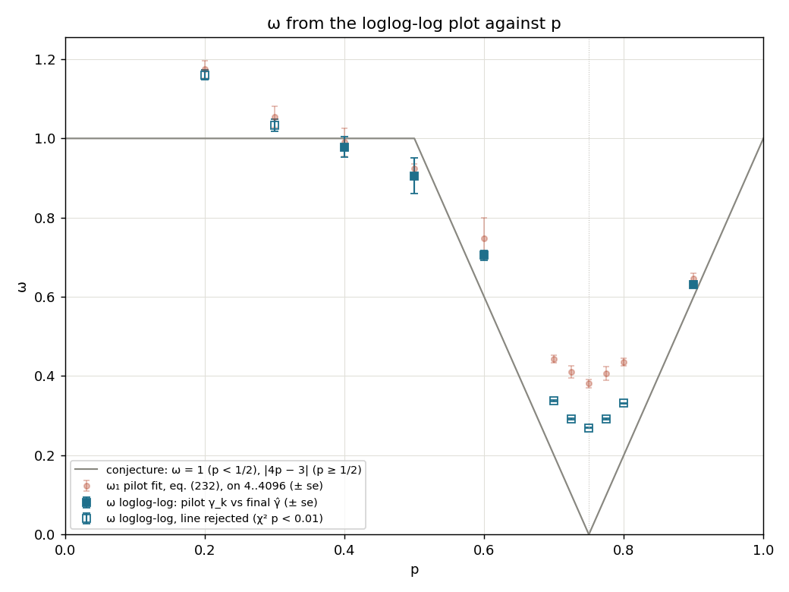

# Experiment 14 — `erw_urn_gpu`: the elephant random walk as an urn, on a GPU

**Question.** Does `MODELS["erw_urn_gpu"]` sample the same distribution as `MODELS["erw"]`
and `MODELS["erw_gpu"]`, closely enough that every estimator gives the same answer on
it? And does each run give the GPU enough samples to keep it busy? Speed only matters
because it buys bigger budgets and longer ladders.

The model, its regimes and the acceptance criteria for $\gamma$ are in
`experiments/11_erw/README.md` and aren't repeated here. `models/erw.py` is unchanged
and taken as correct. Nothing in `src/` or `calibration/` changed. In `tools/`, only the
registry gained the entry.

## Setup

| | |
|---|---|
| hardware | NVIDIA GeForce RTX 5090, 32 GiB (shared card), 170 SMs × 1536 threads |
| software | Python 3.10.12, numpy 2.0.2, scipy 1.13.1, **cupy-cuda12x 14.2.0**, CUDA runtime 12.9 |
| model | `models/erw_urn_gpu.py`: one CUDA thread per sample, state $(m, U_m)$ with $U_m$ the number of $+1$ steps so far, all $k$ steps in one `RawKernel` launch. Each step is two independent coins: a uniform past step is $+1$ ($\lfloor a\,m/2^{64}\rfloor<U_m$), and it's reversed ($b<\lfloor(1-p)2^{64}\rfloor$). This is eq. (2.2)'s chain, all in integers |
| RNG | one `rng.integers(0, 2**63)` per `simulate` call seeds Philox4x32-10. Sample $j$ uses subsequence $j$, so its draw doesn't depend on the launch chunk |
| reproducibility | a seed reproduces a run **on the versions above**. It never reproduces an `erw` or `erw_gpu` run |

### Why the urn (user, 2026-09-28)

The walk's past only enters through the colour of a uniformly picked step, so
$(m,U_m)$ is a sufficient state (Bercu eq. 2.2). `models/erw.py` measured this chain on
CPU and declined it (2026-09-22): a Python loop over $k$ steps. On a GPU, one thread
per sample with two registers of state is the natural shape. There's no trajectory in
memory (8 bytes per sample instead of `erw_gpu`'s ~46 per step) and no doubling passes.

### Why integers (2026-09-28)

A first draft drew one `curand_uniform_double` per step against the folded probability
$(1+(2p-1)S_m/m)/2$: 23 ps/step at a full device. The RTX 5090 runs float64 at 1/64 of
its float32 rate, so that draft was FP64-bound. The integer kernel runs at 2.35 ps/step.
It also makes $P(\text{reverse})=1-p$ exact to $2^{-64}$, with $p=0$ and $p=1$ exact.

## How many samples the GPU needs

A sample is a serial chain on one thread, so a call only uses the device if it has
enough samples. At $k=2^{16}$, $p=0.9$ (2026-09-28):

| $n$ | $2^8$–$2^{15}$ | $2^{16}$ | $2^{17}$ | $2^{18}$ | $2^{19}$ | $2^{20}$–$2^{22}$ |
|---|---|---|---|---|---|---|
| ms per call | 6.8 (flat) | 12.4 | 24.6 | 43.0 | 81.4 | 161–647 |
| ps per step | 407 → 3.17 | 2.88 | 2.86 | 2.50 | 2.37 | 2.34–2.35 |

Up to $2^{15}$ samples a call costs one sample's latency, however many there are. From
`resident_threads()` $=170\times1536=261{,}120\approx2^{18}$ up, a call is within ~7% of
the device's throughput. That's the floor this experiment keeps `n` above.

**Pilot.** `recipes/samples_super_p0.9.json` is 12's pilot template with the budget raised
from $10^9$ to $4\times10^9$. That gives 488,519 draws per scale instead of 122,129, which
is above the floor, for ~10 ms of device work per replicate.

**Final run: `sweep_p.py`'s ceiling.** `plan.py` draws one $n$ at every scale. When
$\omega_1$ is small it spends extra budget by sliding the ladder up, not by raising
$n$. 12's 1-hour sweep ended at $n=131{,}286$ at $p=0.775$, and at ~240× the speed the
same plan would drop $n$ well under the floor. So `sweep_p.py` passes autopilot a
`--max-scale`: the top of the highest ladder on which the final run can still afford
`--min-n` (default: `resident_threads()`) samples per scale per replicate. That's
computed from $(1-\texttt{pilot\_cap})\cdot T$ and the throughput *the plan will use*.
Every lower ladder affords more, so whatever $m_0$ the plan picks, $n\ge$ `--min-n`.
The summary table has a `full device` column that checks this after the fact.

### The pilot's clock underestimates this model (2026-09-28)

The plan's $n$ on a given ladder is $T\cdot\text{throughput}/\sum k$, so the ceiling
must use the plan's throughput. For a batched model that's `pilot.py`'s
$\sum k/\sum(a+bk^d)$ from its cost probe on the pilot's 4..4096. On that ladder the
urn's per-sample fixed cost ($a\approx2.7$ ns, `curand_init` and the write, about 1000
steps' worth) dominates:

| | throughput (steps/s) | $d$ |
|---|---|---|
| pilot probe on 4..4096, four re-runs | 1.80–2.15 × 10¹¹ | 1.07–1.75 (affine) |
| E1 probe on $2^{10}..2^{20}$ | ~3.5 × 10¹¹ | 1.012 ± 0.003 |
| a real final run (smoke, $p=0.9$) | 4.1 × 10¹¹ | – |

So `sweep_p.py` reruns the pilot's own probe (`pilot.resolve_cost`) on the template's
scales and divides by `THROUGHPUT_MARGIN = 1.25` for its spread. The side effect is
that plans are conservative, and a final takes about half of `--time`. $d$ from the
pilot is also poorly identified here: 1.33 ± 0.17 in one smoke pilot, against a true
value of 1. Both are the pipeline measuring $d$ on the pilot's ladder, by design
(`pilot.py`'s `_resolve_d`), and are left as they are. A higher pilot ladder would fix
both, but it's a modelling decision (open question below).

## Acceptance criteria (written 2026-09-28)

**G1. Distribution** (`tools/tests/test_erw_urn_gpu.py`, local, gitignored).
Against `erw` at $k\in\{64,1024\}$ and against `erw_gpu` at $k\in\{2^{14},2^{16}\}$,
each × $p\in\{0.3,0.75,0.9\}$, independent spawned seeds: two-sample KS $p\ge0.01$ and
$\lvert\Delta\bar Y\rvert\le3$ combined se. The tree samplers never form $U_m/m$, so
they're independent references for the urn.

**G2. Exact references** (same file, imported from `test_erw.py`):
- $\chi^2$ against the literal eq. (2.1) law at $k=7$, $n=10^6$;
- $\mathbb E\lvert S_k\rvert$ (DP) and $\mathbb E S_k^2$ (eq. A.3) at $k\in\{64,512,4096\}$,
  $n=2\times10^5$, within 4 se;
- the zero-check at $k=256$ and $2^{18}$;
- $p=1/2$ is `srw`;
- closed cases $p=0$, $p=1$, $k=1$;
- parity and range.

Also checked: the output doesn't depend on the launch chunk and is a prefix in $n$, one
integer is taken from the driver's rng, the flip threshold is exact to $2^{-64}$ at
$p\in\{0,10^{-300},\ldots,1\}$, `cost_hint`/`_check` are `erw`'s own objects, import
doesn't load cupy, and without CUDA `simulate` raises and names `erw`.

**E1. Cost.** `measure_cost.py` on `recipes/cost_probe.json` ($k=2^{10}..2^{20}$), with
the saturation walk. PASS if the affine $\hat d$ is within 20% of the declared $d=1$.

**G3. End to end.** `sweep_p.py` at $p=0.9$ must give $\hat\gamma$ within its Wilson
interval of $2p-1$, with `full device` = yes.

## G1, G2: PASS (2026-09-28)

`python3 -m pytest tools/tests/test_erw_urn_gpu.py`: **62 passed** in 5.8 s. The full
local suite: 592 passed, 12 skipped.

## E1: PASS (2026-09-28, idle card)

```
affine          cost(i) = a + b*i^d  : d_hat = 1.0119   overhead a = 0.00 us   rel_rmse = 0.0112
declared d = 1.0000   (model's cost_hint)
measured d = 1.0119 +/- 0.0031   (affine a + b*i**d)
gap = +3.88 sigma, 1.19% relative
PASS: measured d = 1.0119 against this model's declared 1.0000 (1.2% of it, tolerance 20%)
```

Marginal cost per step, saturated at $n=32768$ at every rung:
4.04, 3.35, 3.06, 2.89, 2.86, 2.79, 2.76, 2.76, 2.77, 2.86, 2.92 ps at
$k=2^{10}..2^{20}$. The small-$k$ excess is the per-sample fixed cost. Against
`erw_gpu`'s E1 (0.50–0.65 ns/step) it's ~200× faster. The +3.9σ is that fixed cost's
curvature over the first rungs: dropping them gives $\hat d$ = 1.003 from $2^{13}$.
A first E1 run while the test suite shared the GPU gave the same $\hat d$.

## G3 and the ceiling: smoke runs (2026-09-28)

`sweep_p.py --tag smoke2 --time 5m --p 0.75 0.9`. The ceiling was `--max-scale
16777216`, on a planner throughput of 2.2 × 10¹¹ / 1.25:

| p | γ true | $\hat\gamma$ ± se | final ladder | n/scale × reps | full device | min |
|---|---|---|---|---|---|---|
| 0.75 | 0.500 | 0.53236 ± 0.00016 | 524288..16777216 | 659,614 × 3 | yes (2.5×) | 2.7 |
| 0.9 | 0.800 | 0.80006 ± 0.00004 | 65536..2097152 | 5,424,026 × 3 | yes | 2.7 |

**G3 PASS at $p=0.9$**: Wilson $[0.7997, 0.8004]$ contains 0.8. At $p=0.75$ the ceiling
bound: the plan would have ended at $2^{25}$. It's conservative, since that ladder would
still have had ~330k samples. At $p=3/4$ the $\sqrt{k\log k}$ law isn't eq. (232)'s form,
so 0.532 is 11_erw's known failure, not the device's (12 read 0.5335 there). Pilot
$\omega_1$ at 0.75: $0.400\pm0.006$, against 12's $0.405\pm0.011$.

A first smoke run with the ceiling sized on the device's own marginal rate
(5.3 × 10¹¹) showed why the planner's rate has to be used: the planner read 1.8 × 10¹¹, so at the cap
$n$ could have fallen to about a third of `min_n`.

## $\omega$ from the loglog-log plot, tag `2h` (2026-10-16)

**Method (user, 2026-10-16).** `tools/loglog_log.py`, driven by
`src/estimate/omega_loglog.py`. In each study, $\gamma_k$ are the consecutive slopes of the
**pilot's** log-log plot (4..4096). $\hat\gamma$ is the **final** run's `answer.json` value,
an independent draw. Under eq. (232),
$\gamma_k-\gamma\propto\rho^{-\omega_1 k}$, so $\omega$ is minus the slope of
$\ln\lvert\gamma_k-\hat\gamma\rvert$ against $\ln k$. The fit is a GLS on the exact
delta-method covariance, because every point shares $\hat\gamma$ and neighbours share a
scale. Only points with $\lvert\gamma_k-\hat\gamma\rvert>3$ sd and the majority sign
enter. The cut was 2 sd at first; exp 19 at $p=\tfrac12$ showed one noise point passing
it, and the user chose 3 sd over any extra rule.

```bash
for s in sweep_p{0.2,0.3,0.4,0.5,0.6,0.7,0.725,0.75,0.775,0.8,0.9}_2h; do
  python3 src/estimate/omega_loglog.py --study $s --data-root experiments/14_erw_urn_gpu/data; done
python3 experiments/14_erw_urn_gpu/plot_sweep.py --tag 2h --omega-loglog
```

| p | $\hat\gamma$ (final) | fitted pairs (count) | ω ± se | χ²/dof | χ² p | ω₁ eq. (232), pilot |
|---|---|---|---|---|---|---|
| 0.2 | 0.50002 | 4..64 (5) | 1.160 ± 0.012 | 27.7/3 | 4.2e-06 | 1.174 |
| 0.3 | 0.49999 | 4..256 (6) | 1.033 ± 0.016 | 15.9/4 | 0.0032 | 1.054 |
| 0.4 | 0.50001 | 4..64 (5) | 0.978 ± 0.025 | 4.1/3 | 0.26 | 0.991 |
| 0.5 | 0.50001 | 4..32 (4) | 0.906 ± 0.045 | 0.1/2 | 0.94 | 0.924 |
| 0.6 | 0.50005 | 4..256 (7) | 0.705 ± 0.012 | 3.8/5 | 0.58 | 0.747 |
| 0.7 | 0.50305 | 4..2048 (10) | 0.337 ± 0.002 | 157.6/8 | 5.2e-30 | 0.443 |
| 0.725 | 0.51047 | 4..2048 (10) | 0.292 ± 0.002 | 219.0/8 | 6.3e-43 | 0.410 |
| 0.75 | 0.52707 | 4..2048 (10) | 0.269 ± 0.001 | 226.7/8 | 1.5e-44 | 0.381 |
| 0.775 | 0.56018 | 4..2048 (10) | 0.291 ± 0.001 | 257.8/8 | 3.8e-51 | 0.407 |
| 0.8 | 0.60298 | 4..2048 (10) | 0.331 ± 0.002 | 174.9/8 | 1.2e-33 | 0.435 |
| 0.9 | 0.80005 | 4..512 (7) | 0.631 ± 0.008 | 3.2/5 | 0.66 | 0.645 |

**What it shows.**
- **Line accepted ($p=0.4,0.5,0.6,0.9$):** ω agrees with the pilot's eq. (232)
  $\omega_1$ within about 1 se of the combined error. At $p=0.6$ it's 0.705 ± 0.012
  against 0.747 ± 0.052.
- **$p=0.2,0.3$:** ω = 1.16 and 1.03. Close to eq. (232), but the line is rejected
  (χ² p < 0.01).
- **$0.7\le p\le0.8$:** ω = 0.27–0.34, about 0.1 below eq. (232), with χ²/dof 20–30.
  The plot bends there. The final's $\hat\gamma$ is itself biased (0.527 at $p=\tfrac34$,
  against a true $\tfrac12$), and $\lvert\gamma_k-\hat\gamma\rvert$ inherits that offset.
  Neither ω is close to the conjecture $\lvert4p-3\rvert$ on this window.



## Open

- **The sweep.** `python3 experiments/14_erw_urn_gpu/sweep_p.py --tag 1h --time 1h`
  runs 12's grid (11 × 1h). Its results go to `data/sweep_p_1h.md` and belong here once
  measured.
- **Pilot ladder (user's call).** At this speed a pilot on e.g. 64..65536 costs ~0.5 s
  and would give the planner a clean $d$ and throughput. But it changes where
  $\omega_1$ is measured, and it breaks the like-for-like with 12's pilots.

## Wilson interval with the pinned pilot refit, tag `2h` (2026-11-02)

**Change (user, 2026-11-02).** `report.py` now builds $B_{fs}$ of eq. (720) from the pilot
refitted with $\gamma$ pinned to the final's $\hat\gamma$ (`tools/correction.py`'s
`fit_correction_pinned`), not from the plan's $\gamma$-free fit. Its $\chi^2$ (N − 3 dof)
is a warning only, at p < 0.01. Every study was re-reported; nothing was redrawn.

| p | Wilson 95% (new) | contains γ | refit $\omega_1$ | refit χ² p | old Wilson 95% |
|---|---|---|---|---|---|
| 0.05 | [0.500005, 0.500050] | no | 1.227 | 4e-19 | [0.50001, 0.50005] (no) |
| 0.1 | [0.500003, 0.500051] | no | 1.205 | 3e-14 | [0.50001, 0.50005] (no) |
| 0.15 | [0.499996, 0.500045] | yes | 1.185 | 4e-12 | [0.50000, 0.50004] (no) |
| 0.65 | [0.49978, 0.50100] | yes | 0.486 | 2e-8 | [0.50015, 0.50063] (no) |
| 0.7 | [0.49893, 0.50717] | yes | 0.338 | 4e-28 | [0.50199, 0.50410] (no) |
| 0.725 | [0.50036, 0.52059] | no | 0.293 | 2e-41 | [0.50885, 0.51210] (no) |
| 0.775 | [0.54996, 0.57041] | yes | 0.293 | 1e-47 | [0.55853, 0.56184] (no) |
| 0.8 | [0.59838, 0.60759] | yes | 0.332 | 1e-31 | [0.60176, 0.60421] (no) |

The other 12 non-critical p contain γ before and after. Coverage 12/20 → 17/20. All three
misses warn. The warning also fires at 0.15, 0.2, 0.65–0.85 (7 covered values) and at
p = 3/4. At p = 0.05 the miss is bias, not noise: exact $E|S_i|$ (DP to $2^{17}$, the
last point extended with local exponent 1.000) gives $\hat\gamma-\tfrac12=2.80\times10^{-5}$
on $2^{13}..2^{18}$, against the measured $2.76\times10^{-5}$, with $B_{fs}=0.93\times10^{-5}$.


## Wilson interval in the article's three-term form, tag `2h` (2026-11-04)

**Change (user, 2026-11-04).** The article dropped the logarithmic-moment assumption, and
Theorem cor:wilson lost its $B_{bad}$ term with it. Now
$W = \Phi^{-1}(1-\alpha/2)\sqrt{12\sigma_\infty^2/(n\,m(m^2-1))} + B_{fs} + 6\sigma^2_{\max}/(n(m+1))$:
$B_{good}$ lost its $(c_0+2)$ factor, and the SE carries the exact $m(m^2-1)$, so it is
$\sqrt{36/35}$ wider than the old $m^3$ form at $m=6$. $\hat\gamma$ and $B_{fs}$ are unchanged
(same pinned refit). Every study was re-reported; nothing was redrawn.

| p | Wilson 95% (three-term) | contains γ | half-width new/old | four-term (2026-11-02) | contains γ |
|---|---|---|---|---|---|
| 0.05 | [0.500007, 0.500049] | **no** | 0.92 | [0.500005, 0.500050] | **no** |
| 0.1 | [0.500005, 0.500049] | **no** | 0.92 | [0.500003, 0.500051] | **no** |
| 0.15 | [0.499998, 0.500043] | yes | 0.92 | [0.499996, 0.500045] | yes |
| 0.2 | [0.499988, 0.500049] | yes | 0.91 | [0.499984, 0.500052] | yes |
| 0.25 | [0.499979, 0.500028] | yes | 0.89 | [0.499976, 0.500031] | yes |
| 0.3 | [0.499951, 0.500028] | yes | 0.86 | [0.499945, 0.500034] | yes |
| 0.35 | [0.499977, 0.500035] | yes | 0.91 | [0.499974, 0.500038] | yes |
| 0.4 | [0.499972, 0.500053] | yes | 0.91 | [0.499968, 0.500057] | yes |
| 0.45 | [0.499973, 0.500032] | yes | 0.86 | [0.499968, 0.500037] | yes |
| 0.5 | [0.499974, 0.500041] | yes | 0.86 | [0.499969, 0.500046] | yes |
| 0.55 | [0.499964, 0.500032] | yes | 0.87 | [0.499959, 0.500037] | yes |
| 0.6 | [0.499918, 0.500186] | yes | 0.88 | [0.499900, 0.500204] | yes |
| 0.65 | [0.499808, 0.500971] | yes | 0.95 | [0.499776, 0.501003] | yes |
| 0.7 | [0.499139, 0.506956] | yes | 0.95 | [0.498930, 0.507166] | yes |
| 0.725 | [0.500620, 0.520329] | **no** | 0.97 | [0.500361, 0.520587] | **no** |
| 0.75 | [0.513489, 0.540651] | — | 0.97 | [0.513075, 0.541065] | — |
| 0.775 | [0.550202, 0.570167] | **no** | 0.98 | [0.549960, 0.570408] | yes |
| 0.8 | [0.598622, 0.607348] | yes | 0.95 | [0.598376, 0.607594] | yes |
| 0.85 | [0.699736, 0.700665] | yes | 0.88 | [0.699674, 0.700727] | yes |
| 0.9 | [0.799914, 0.800185] | yes | 0.91 | [0.799901, 0.800198] | yes |
| 0.95 | [0.899982, 0.900026] | yes | 0.92 | [0.899980, 0.900028] | yes |

Coverage 17/20 → 16/20. The one change is p = 0.775, which now misses $2p-1=0.55$ by
$2.0\times10^{-4}$. The bound there is all $B_{fs}$ ($9.6\times10^{-3}$ of $1.0\times10^{-2}$),
and its refit warns ($\chi^2$ p = 1e-47), so the miss is the warned one-correction
failure near p = 3/4, not the dropped term. All four misses warn.

## Wilson interval with the AIC pilot refit (2026-11-07)

B_fs now takes $\omega_1, a_1$ from the pilot refitted with $\gamma$ pinned to $\hat\gamma$ on a range of
$\ge 5$ consecutive pilot scales chosen by AIC with data cuts (Jay & Neil 2021;
`local_slope.omega_ranges`, `report.pinned_refit`), not on every pilot scale as in the
2026-11-02 refit. $\hat\gamma$ is unchanged; only the eq. (720) half-width moves. The
$\omega_1$ error is the profile error $\oplus$ the spread over ranges. Old = all-scales pinned
refit (kept in `answer.json` as `pilot_refit_all_scales`), new = AIC refit (`pilot_refit`);
reports rerun 2026-11-07. A warning is $\chi^2$ $p < 0.01$ (old: or $\omega_1$ on its bound). ✓/✗: the interval contains / misses the exact $\gamma$.

| study | $\hat\gamma$ | old $\hat\omega_1$ | old $\chi^2$/dof | old radius | new $\hat\omega_1$ | range | new $\chi^2$/dof | new radius |
|---|---|---|---|---|---|---|---|---|
| `sweep_p0.05_2h` | 0.500028 | 1.23 ± 0.0078 | 105/8 ⚠ | 2.09e-05 ✗ | 1.09 ± 0.099 | 8..2048 | 3.65/6 | 3.61e-05 ✓ |
| `sweep_p0.05_smoke` | 0.500069 | 1.22 ± 0.0077 | 61.8/8 ⚠ | 6.14e-05 ✗ | 1.07 ± 0.049 | 16..4096 | 2.2/6 | 9.76e-05 ✓ |
| `sweep_p0.15_2h` | 0.500020 | 1.18 ± 0.0086 | 70.4/8 ⚠ | 2.26e-05 ✓ | 1.01 ± 0.071 | 16..4096 | 2.09/6 | 5.07e-05 ✓ |
| `sweep_p0.1_2h` | 0.500027 | 1.21 ± 0.0081 | 81.2/8 ⚠ | 2.19e-05 ✗ | 1 ± 0.085 | 16..4096 | 3.3/6 | 5.48e-05 ✓ |
| `sweep_p0.25_2h` | 0.500003 | 1.09 ± 0.01 | 16.6/8 | 2.45e-05 ✓ | 1.02 ± 0.063 | 8..4096 | 3.21/7 | 3.04e-05 ✓ |
| `sweep_p0.2_2h` | 0.500018 | 1.14 ± 0.0094 | 36.6/8 ⚠ | 3.08e-05 ✓ | 1.05 ± 0.058 | 8..4096 | 5.3/7 | 4.38e-05 ✓ |
| `sweep_p0.35_2h` | 0.500006 | 0.993 ± 0.014 | 3.83/8 | 2.9e-05 ✓ | 1.03 ± 0.042 | 8..4096 | 1.79/7 | 2.6e-05 ✓ |
| `sweep_p0.3_2h` | 0.499989 | 1.04 ± 0.012 | 10.4/8 | 3.82e-05 ✓ | 1 ± 0.047 | 8..4096 | 6.88/7 | 4.19e-05 ✓ |
| `sweep_p0.45_2h` | 0.500002 | 0.928 ± 0.021 | 13.9/8 | 2.96e-05 ✓ | 1.54 ± 0.42 | 32..2048 | 2.22/4 | 2.26e-05 ✓ |
| `sweep_p0.4_2h` | 0.500012 | 0.987 ± 0.017 | 10.8/8 | 4.07e-05 ✓ | 0.992 ± 0.13 | 4..1024 | 6.04/6 | 4e-05 ✓ |
| `sweep_p0.55_2h` | 0.499998 | 0.89 ± 0.019 | 10.2/8 | 3.4e-05 ✓ | 0.89 ± 0.084 | 4..4096 | 10.2/8 | 3.4e-05 ✓ |
| `sweep_p0.5_2h` | 0.500007 | 0.954 ± 0.025 | 5.3/8 | 3.35e-05 ✓ | 0.954 ± 0.049 | 4..4096 | 5.3/8 | 3.35e-05 ✓ |
| `sweep_p0.65_2h` | 0.500390 | 0.486 ± 0.0042 | 51.1/8 ⚠ | 0.000581 ✓ | 0.437 ± 0.044 | 16..2048 | 2.48/5 | 0.000993 ✓ |
| `sweep_p0.6_2h` | 0.500052 | 0.692 ± 0.0093 | 10.8/8 | 0.000134 ✓ | 0.701 ± 0.073 | 4..2048 | 4.74/7 | 0.000127 ✓ |
| `sweep_p0.725_2h` | 0.510474 | 0.293 ± 0.0017 | 212/8 ⚠ | 0.00985 ✗ | 0.249 ± 0.011 | 32..4096 | 1.56/5 | 0.0205 ✓ |
| `sweep_p0.75_2h` | 0.527070 | 0.27 ± 0.0015 | 216/8 ⚠ | 0.0136 | 0.296 ± 0.035 | 8..128 | 0.334/2 | 0.00822 |
| `sweep_p0.775_2h` | 0.560184 | 0.293 ± 0.0016 | 241/8 ⚠ | 0.00998 ✗ | 0.315 ± 0.041 | 8..128 | 0.524/2 | 0.00657 ✗ |
| `sweep_p0.7_2h` | 0.503048 | 0.338 ± 0.002 | 148/8 ⚠ | 0.00391 ✓ | 0.295 ± 0.015 | 32..4096 | 2.64/5 | 0.00747 ✓ |
| `sweep_p0.85_2h` | 0.700201 | 0.472 ± 0.003 | 28.9/8 ⚠ | 0.000465 ✓ | 0.426 ± 0.027 | 16..512 | 1.31/3 | 0.000761 ✓ |
| `sweep_p0.8_2h` | 0.602985 | 0.332 ± 0.0017 | 166/8 ⚠ | 0.00436 ✓ | 0.286 ± 0.021 | 32..4096 | 3.4/5 | 0.00881 ✓ |
| `sweep_p0.95_2h` | 0.900004 | 0.818 ± 0.012 | 12.4/8 | 2.2e-05 ✓ | 0.809 ± 0.11 | 4..2048 | 7.25/7 | 2.27e-05 ✓ |
| `sweep_p0.9_2h` | 0.800050 | 0.634 ± 0.0056 | 5.99/8 | 0.000135 ✓ | 0.634 ± 0.018 | 4..4096 | 5.99/8 | 0.000135 ✓ |

Coverage of the exact $\gamma$: old 16/21, new 20/21.

These are the article's ERW tables (`tab:erw-gamma`, `tab:erw-omega`) and `erw_omega_vs_p.pdf`,
regenerated with `plot_sweep.py --tag 2h --article`. For $0.1 \le p \le 0.35$ the AIC refit gives
$\hat\omega_1 = 1.00$–$1.05$, the conjectured 1, where the all-scales refit gave up to 1.23. The one
miss, $p = 0.775$, and $p = 3/4$ both chose the short range $8..128$ and no longer warn: there the
length of the range, not the $\chi^2$, is what says one correction does not describe the pilot.
