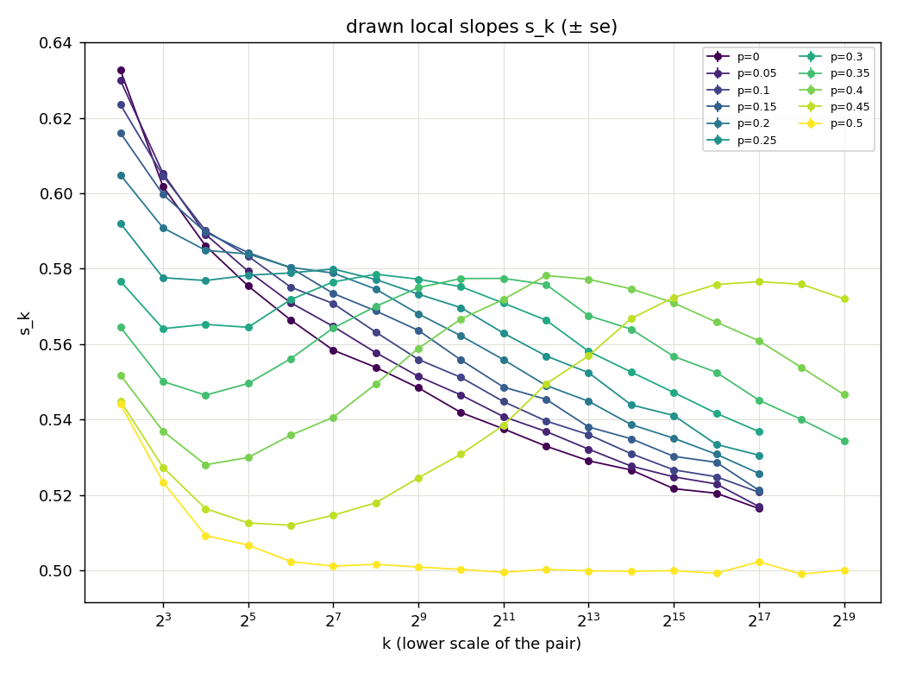
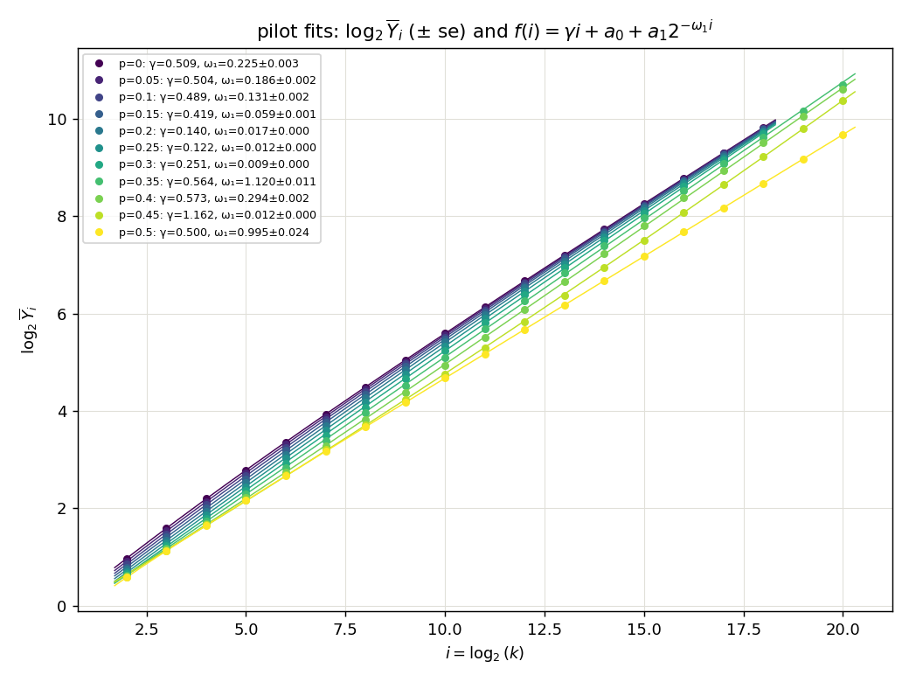
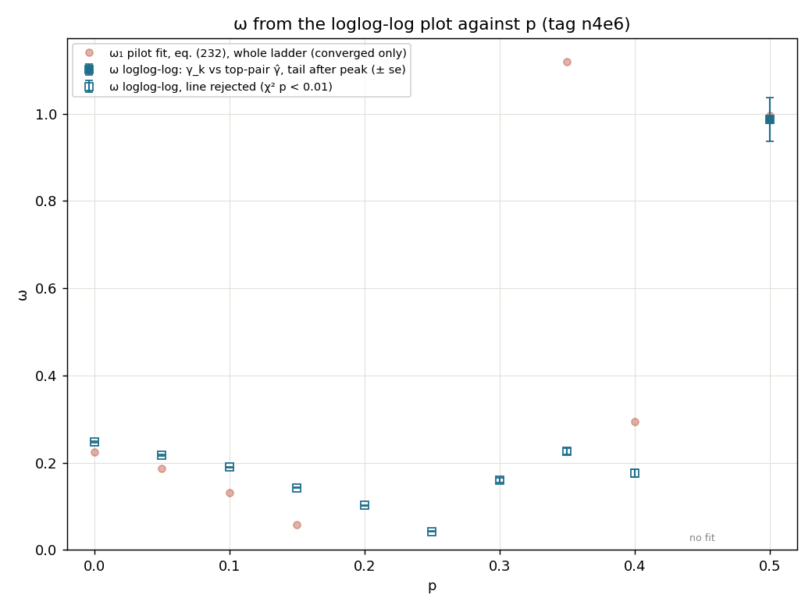
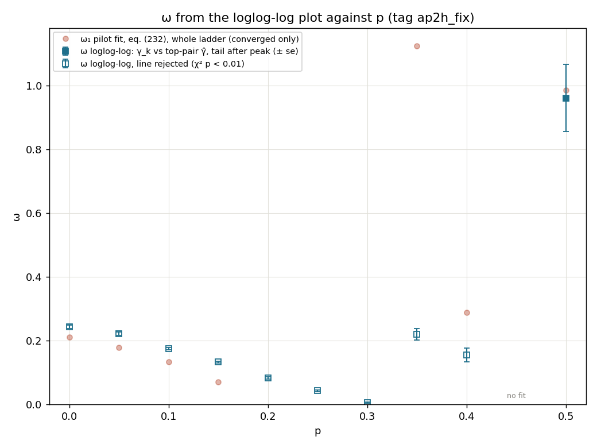

# Experiment 19 — `rwre`'s correction exponent across $p\in[0,\tfrac12]$, on the lazy GPU model

**Question (user, 2026-10-03).** 13's `RWRE_longsieve` and 16's hump show that the pilot fit
of eq. (232) on 4..1024 does not determine $\omega_1$ for $p$ away from 0 and from $\tfrac12$
(not converged, $\omega_1\to0$, Wilson bounds of $\pm100$). With `rwre_gpu_lazy` (18), which reaches
$k=2^{20}$, take the ladder and $n$ that a 2h autopilot chooses at $p=0$, run them at every
$p$ of a grid on $[0,\tfrac12]$, and see whether $\omega$ is similar across $p$. This is
exploratory: there is no pass/fail criterion (user, 2026-10-03). It reports $\omega(p)$ and
the figures.

## Design (decided with the user, 2026-10-03)

**Step 1, autopilot at $p=0$.** `recipes/samples_autopilot_p0.json` is 13's p=0 pilot recipe
(`13_rwre_gpu/recipes/samples_sweep_p0.json`: 4..1024 dyadic, snr rule, budget $10^9$) with
the model swapped to `rwre_gpu_lazy` and `window_exponent` dropped. `--time 2h`,
`--replicates 5`, no `--max-scale`, seed 20261003 (rerun after the units fix as seed 20261005; the sweep then used 20261006).
- If a sample outgrows `cap` (the model raises), or the gate gives up and draws nothing,
  everything stops and goes back to the user to re-plan.

**Step 2, the sweep.** `omega_sweep.py` reads step 1's `plan.json`. Its top scale $K$,
$n$ per scale and replicate count $R$ are the only things taken from it. For each
$p\in\{0,0.05,\dots,0.5\}$ (11 values), one `src/study/pilot.py` study runs on the dyadic
ladder $4..K$ at that flat $n$ × $R$, in sequence on one GPU. Seed 20261004 $+$ the index
of $p$. Per $p$, it reports:
- pilot.py's own eq. (232) fit on the whole ladder ($\gamma$, $\omega_1$ ± its se), drawn
  as $\log_2\overline Y_i$ against $i$ (17's `pilot_fit` figure);
- the drawn local slopes $s_k$ (± CLT se), at the lower scale of each pair;
- (P) $\gamma+ck^{-\omega}$ and (L) $\gamma+c/\ln k$ on the $s_k$, on the whole ladder and on
  the tail $k\ge256$. 16 showed that windows including $k\lesssim$ a few hundred are
  misspecified for $p\ne\frac12$, which is why the tail fit is there.

The model is $\lvert X_k\rvert$ under 18's defaults ($\alpha=\tfrac12$, `env_sweeps` 4,
bit layout, `cap` $2^{15}$, skip-read on). $\lvert X_k\rvert$ has the same law at $p$ and
$1-p$, so $[0,\tfrac12]$ covers everything.

```bash
# on a free GPU host (amazonas, 2026-10-03)
python3 src/study/autopilot.py -meta experiments/19_rwre_lazy_omega/recipes/samples_autopilot_p0.json \
    --study autopilot_p0_fix --data-root experiments/19_rwre_lazy_omega/data --time 2h \
    --replicates 5 --seed 20261005
python3 experiments/19_rwre_lazy_omega/omega_sweep.py --from-study autopilot_p0_fix --tag ap2h_fix --seed 20261006
```

Results go to `data/omega_<tag>.{md,json}`, `data/pilot_fit_<tag>.png` and
`data/slopes_<tag>.png`, and are recorded here once measured.

Smoke run (2026-10-03, solimoes, a hand-written plan of 4..1024, $n=2\times10^4$ × 2,
$p\in\{0,0.3,0.5\}$): all three pilots exit 0, and the table and figures are written. That
shows the path works, not anything about $\omega$.

## Results, tag `ap2h_fix` (2026-10-04, amazonas)

**The run.** The first autopilot (`autopilot_p0`) planned $n=6054$ because of the pilot.py
throughput-units bug (fixed in 6119345), so it was discarded. The rerun, `autopilot_p0_fix`
(seed 20261005), had pilot constants $d=1.153\pm0.008$, $\omega_1=0.450\pm0.001$,
$a_1=-0.430$ and cv $0.732$ on 4..1024. It accepted $m_0=14$ (32768..$2^{20}$),
$n=152{,}604$ ×5, predicted at 94.6 min. The draw took 46.0 min (0.49×) and gave
$\hat\gamma=0.5180\pm0.0055$.

**The sweep** (seed 20261006) ran 4..$2^{20}$ at that $n$×5 for each of the 11 values of
$p$. Every $p$ exited 0 with no `cap` overflow, at 28–46 min each. The table is
`data/omega_ap2h_fix.md`. The figures are copied to `images/pilot_fit_ap2h_fix.png` and
`images/slopes_ap2h_fix.png`.

| p | eq. (232) on 4..$2^{20}$: γ, ω₁ | (P) $k\ge256$: γ, ω | (L) $k\ge256$: γ |
|---|---|---|---|
| 0 | 0.506, 0.211 ± 0.002 | 0.495, 0.15 ± 0.04 | 0.486 |
| 0.05 | 0.502, 0.179 ± 0.004 | 0.484, 0.11 ± 0.04 | 0.486 |
| 0.1 | 0.490, 0.133 ± 0.004 | 0.487, 0.13 ± 0.03 | 0.483 |
| 0.15 | 0.444, 0.071 ± 0.002 | 0.478, 0.11 ± 0.03 | 0.484 |
| 0.2 | 0.124, 0.016 (not converged) | 0.450, 0.08 ± 0.03 | 0.483 |
| 0.25 | 0.043, 0.011 (not converged) | 0.337, 0.04 ± 0.03 | 0.487 |
| 0.3 | 0.135, 0.009 (not converged) | ω at bound | 0.496 |
| 0.35 | 0.564, 1.13 ± 0.02 | ω at bound | 0.517 |
| 0.4 | 0.574, 0.289 ± 0.006 | 0.567, 1.9 ± 0.5 (χ² p≈0) | 0.566 |
| 0.45 | 1.157, 0.012 (not converged) | 0.592, 0.23 ± 0.03 (χ² p≈0) | 0.627 |
| 0.5 | 0.4998, 0.987 ± 0.018 | 0.4998, ω unidentified | 0.4996 |

**What it shows.**
- $\omega$ is not similar across $p$, so the $p=0$ recipe does not transfer.
- **$p\le0.15$:** $s_k$ falls monotonically, but $\omega_1$ depends on the window. It is
  0.45 on 4..1024 and 0.21 on 4..$2^{20}$, and the tail-only (P) fit gives 0.11–0.15.
  A single power-law correction is misspecified even out to $k=2^{20}$.
- **$0.2\le p\le0.45$:** $s_k$ has a hump, and its peak moves right as $p\to\tfrac12$:
  about $2^7$ at $p=0.25$, $2^{10}$–$2^{11}$ at 0.3–0.35, $2^{13}$ at 0.4, and $\gtrsim2^{17}$
  at 0.45. Up to the hump, eq. (232) fails or is meaningless. For $p\ge0.35$, $s_k$ is
  still at 0.53–0.57 at $2^{19}$.
- **$p=\tfrac12$:** $s_k$ is flat at 0.500 from $k\approx32$ on, with $\omega_1\approx1$.
- The tail (L) fit gives $\gamma\approx0.483$–$0.487$ for every $p\le0.25$, but its χ²
  p-values are 0.014 down to $10^{-12}$.


## Results, tag `n4e6` (2026-10-05 to 07, niagara, purus, amazonas)

**Why it was run (user, 2026-10-05).** `ap2h_fix`'s $n=152{,}604$ is too small to tell the tail fits
apart. This sweep uses $n=800{,}000$ × 5 per scale, which matches 16's se: about $\pm0.0008$ on
each $s_k$. The ladder is $4..2^{20}$ for $p\ge0.35$, where the hump needs the top scales, and
$4..2^{18}$ for $p\le0.3$, to save cost. A $2^{20}$ rung costs about 27 min per replicate,
against about 4.5 min for $2^{18}$. So the curves for $p\le0.3$ stop at $s_{2^{17}}$ in the
figures. Seed 20261007 $+$ the index of $p$ in `P_GRID`.

The grid was split over three hosts. Tarim and xingu were the plan, but tarim's Ubuntu 24.04
/ Python 3.12 can't use the repo's 3.10 `.venv`, and xingu's GPU was busy. So their shares
moved to purus and amazonas (2026-10-06). Each host ran
`data/chain_n4e6_<host>.sh`, a pair of commands of the form

```bash
python3 experiments/19_rwre_lazy_omega/omega_sweep.py --from-study autopilot_p0_fix --tag n4e6 \
    --seed 20261007 --n 800000 --top 1048576 --p 0.35 0.5   # --top 262144 for p <= 0.3
```

and then everything was pooled with the same command plus `--analyse-only` and no `--top`/`--p`.
Every $p$ exited 0. The draws took 42–46 min per $p$ on $4..2^{18}$ and 146–235 min on
$4..2^{20}$. The table is `data/omega_n4e6.md`, and the figures are
`images/{pilot_fit,slopes}_n4e6.png`.

| p | eq. (232) on the whole ladder: γ, ω₁ | (P) $k\ge256$: γ, ω, χ² p | (L) $k\ge256$: γ, χ² p |
|---|---|---|---|
| 0 | 0.509, 0.225 ± 0.003 | 0.494, 0.153 ± 0.024, 0.54 | 0.485, 0.006 |
| 0.05 | 0.504, 0.186 ± 0.002 | 0.480, 0.114 ± 0.022, 0.26 | 0.485, 6e-7 |
| 0.1 | 0.489, 0.131 ± 0.002 | 0.489, 0.135 ± 0.021, 0.67 | 0.485, 3e-5 |
| 0.15 | 0.419, 0.059 ± 0.001 | 0.480, 0.119 ± 0.018, 9e-4 | 0.483, 2e-12 |
| 0.2 | not converged | 0.458, 0.087 ± 0.017, 0.73 | 0.486, 1e-15 |
| 0.25 | not converged | ω at bound | 0.492, ≈0 |
| 0.3 | not converged | ω at bound | 0.505, ≈0 |
| 0.35 | 0.564, 1.12 ± 0.01 | ω at bound | 0.519, 0 |
| 0.4 | 0.573, 0.294 ± 0.002 | 0.567, 1.9 ± 0.2, 0 | 0.566, 0 |
| 0.45 | not converged | 0.593, 0.231 ± 0.011, ≈0 | 0.628, ≈0 |
| 0.5 | 0.5000, 0.995 ± 0.024 | 0.5000, 1.4 ± 1.5, 0.19 | 0.499, 0.15 |

**What it shows.** These are `ap2h_fix`'s conclusions, with error bars about 2.3× smaller.
- **$p\le0.15$:** $s_k$ falls monotonically and reaches only 0.516–0.521 at $k=2^{17}$. The
  tail (P) fit is now acceptable ($\chi^2$ p = 0.26–0.67, except 9e-4 at $p=0.15$), with
  $\omega\approx0.11$–$0.15$ and $\gamma\approx0.48$–$0.49$. That is below $\tfrac12$ by 1.0–2.0
  of its se (0.006–0.011). The whole-ladder fits still give a different
  $\omega$ ($0.06$–$0.26$) with
  $\chi^2$ p ≈ 0.
- **$0.2\le p\le0.45$:** $s_k$ is flat up to $2^7$ at $p=0.2$, then has a hump that peaks at
  about $2^7$ (0.25), $2^8$ (0.3), $2^{10}$ (0.35), $2^{12}$ (0.4) and $2^{17}$ (0.45). The
  fits here are not meaningful. At $p=0.45$, $s_{2^{19}}=0.572$.
- **$p=\tfrac12$:** flat at 0.500 from $k\approx64$, $\omega_1=0.995\pm0.024$.




## $\omega$ from the loglog-log plot, tags `n4e6` and `ap2h_fix` (2026-10-16)

**Method (user, 2026-10-16).** The loglog-log plot of `tools/loglog_log.py`: $\omega$ is minus
the slope of $\ln\lvert\gamma_k-\hat\gamma\rvert$ against $\ln k$, where $\gamma_k$ are the
consecutive slopes. Under eq. (232), $\gamma_k-\gamma\propto\rho^{-\omega_1k}$. This
experiment's studies are pilot-only, with no final run, so it has its own driver,
`omega_loglog_top.py`, as a case separate from the general `src/estimate/omega_loglog.py`:
- $\hat\gamma$ is the slope of the top pair, the same draw as the $\gamma_k$. The covariance
  of $D_k=\gamma_k-\hat\gamma$ is exact, and the fit is a GLS on it (delta method for the log).
- The window starts at the argmax of $\gamma_k$ after its last rise resolved at 3 se, so a
  resolved hump is cut off. Without one, the window is the whole ladder.
- Inside the window, the points with $\lvert D_k\rvert>3$ sd and the majority sign are fitted.

Two rules were tried and dropped with the user (2026-10-16):
- A 2-sd cut let one noise point at $p=\tfrac12$, $k=2^{17}$, pull $\omega$ to 0.53.
- "The last $\gamma_k$ above both neighbours by more than 2 se" can't see a hump's flat
  top ($z=0.0$ between $2^{10}$ and $2^{11}$ at $p=0.35$), and it fired on that same point.

```bash
python3 experiments/19_rwre_lazy_omega/omega_loglog_top.py --tag n4e6      # and --tag ap2h_fix
```

Tables: `data/omega_loglog_vs_p_<tag>.md`. Per study: `omega_loglog_top.{json,png}`.

| p | n4e6: $\hat\gamma$ (top pair) | window from | points | ω ± se | χ²/dof | χ² p | ap2h_fix: ω ± se, χ² p |
|---|---|---|---|---|---|---|---|
| 0 | 0.5164 ± 0.0008 | 4 | 15 | 0.247 ± 0.002 | 481.7/13 | 1e-94 | 0.244 ± 0.005, 1e-10 |
| 0.05 | 0.5169 ± 0.0008 | 4 | 15 | 0.217 ± 0.001 | 311.8/13 | 8e-59 | 0.222 ± 0.005, 9e-9 |
| 0.1 | 0.5207 ± 0.0008 | 4 | 15 | 0.189 ± 0.001 | 276.2/13 | 2e-51 | 0.175 ± 0.004, 5e-8 |
| 0.15 | 0.5212 ± 0.0008 | 4 | 15 | 0.142 ± 0.001 | 489.1/13 | 3e-96 | 0.133 ± 0.003, 7e-11 |
| 0.2 | 0.5257 ± 0.0008 | 4 | 15 | 0.102 ± 0.001 | 930.6/13 | 1e-190 | 0.083 ± 0.003, 4e-25 |
| 0.25 | 0.5306 ± 0.0008 | 4 | 14 | 0.042 ± 0.001 | 984.2/12 | 5e-203 | 0.043 ± 0.002, 3e-40 |
| 0.3 | 0.5368 ± 0.0008 | 256 | 9 | 0.160 ± 0.005 | 227.7/7 | 2e-45 | 0.005 ± 0.002 (window from 4), 4e-64 |
| 0.35 | 0.5343 ± 0.0008 | 2048 | 8 | 0.227 ± 0.007 | 87.2/6 | 1e-16 | 0.220 ± 0.018, 0.002 |
| 0.4 | 0.5466 ± 0.0007 | 4096 | 7 | 0.176 ± 0.009 | 72.6/5 | 3e-14 | 0.155 ± 0.022, 3e-4 |
| 0.45 | 0.5720 ± 0.0007 | 131072 | 2 | no fit | – | – | no fit (1 point) |
| 0.5 | 0.5001 ± 0.0008 | 4 | 4 | 0.987 ± 0.050 | 5.3/2 | 0.072 | 0.962 ± 0.105, 0.42 |

**What it shows.**
- **$p=\tfrac12$:** the line is accepted in both tags, with $\omega=0.99\pm0.05$ and
  $0.96\pm0.10$, matching eq. (232)'s $0.995$ and $0.987$.
- **$p<\tfrac12$:** the line is rejected everywhere. $\omega$ falls from 0.25 at $p=0$ to
  0.04 at $p=0.25$, then rises to 0.16–0.23 past the hump at $p=0.3$–$0.4$. The two tags
  agree within a few se, except at $p=0.3$, where only n4e6 resolves the rise before the
  hump.
- The top-pair $\hat\gamma$ is still 0.516–0.572 for $p<\tfrac12$. So $D_k=C(r^k-r^{K-1})$
  bends down near the top, and this variant can't produce a straight line there even
  under a pure power law. This is the same picture as the earlier sections: no single
  power-law correction describes $s_k$ on these ladders for $p\ne\tfrac12$.
- At $p=0.35$ the GLS line sits beside the points rather than through them. That's GLS
  with strongly correlated errors under a wrong model. χ² already rejects it.



