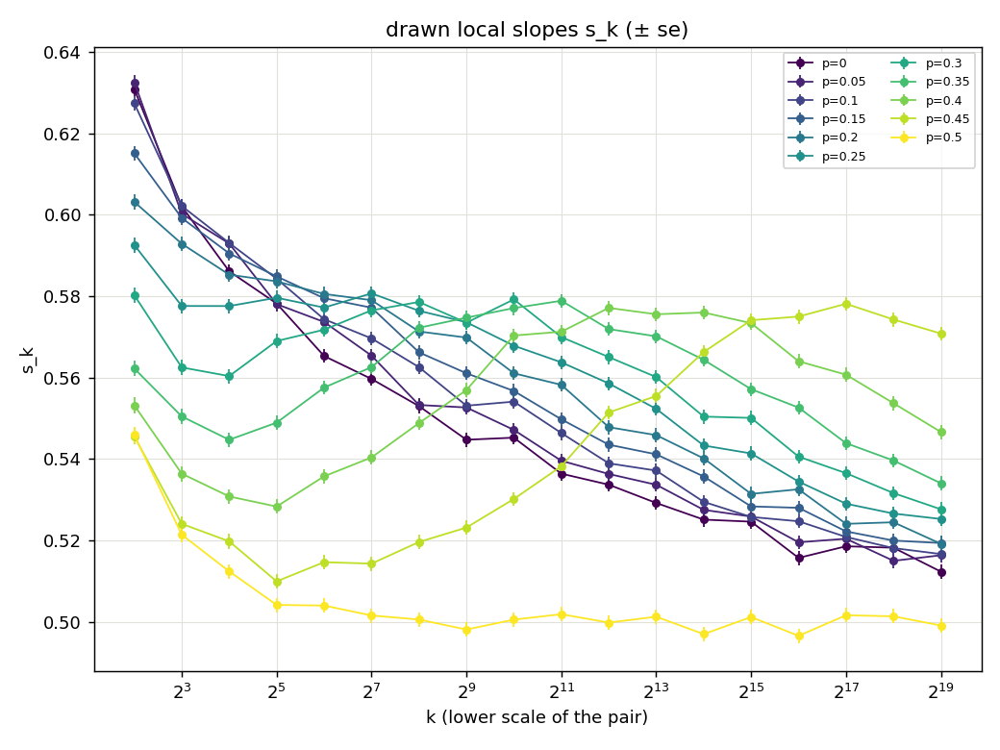
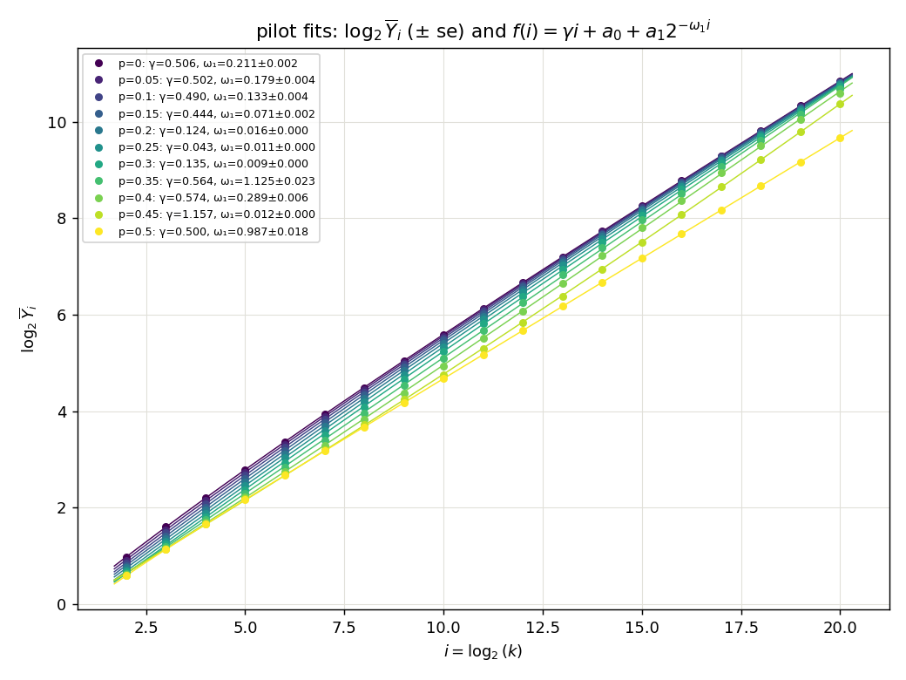

# Experiment 19 — `rwre`'s correction exponent across $p\in[0,\tfrac12]$, on the lazy GPU model

**Question (user, 2026-10-03).** 13's `RWRE_longsieve` and 16's hump show that the pilot fit
of eq. (232) on 4..1024 does not determine $\omega_1$ for $p$ away from 0 and from $\tfrac12$
(not converged, $\omega_1\to0$, Wilson bounds of $\pm100$). With `rwre_gpu_lazy` (18), which reaches
$k=2^{20}$, take the ladder and $n$ that a 2h autopilot chooses at $p=0$, run them at every
$p$ of a grid on $[0,\tfrac12]$, and see whether $\omega$ is similar across $p$. This is
exploratory: there is no pass/fail criterion (user, 2026-10-03). It reports $\omega(p)$ and
the figures.

## Design (decided with the user, 2026-10-03)

**Step 1, autopilot at $p=0$.** `recipes/samples_autopilot_p0.json` is 13's p=0 pilot recipe
(`13_rwre_gpu/recipes/samples_sweep_p0.json`: 4..1024 dyadic, snr rule, budget $10^9$) with
the model swapped to `rwre_gpu_lazy` and `window_exponent` dropped. `--time 2h`,
`--replicates 5`, no `--max-scale`, seed 20261003 (rerun after the units fix as seed 20261005; the sweep then used 20261006).
- If a sample outgrows `cap` (the model raises), or the gate gives up and draws nothing,
  everything stops and goes back to the user to re-plan.

**Step 2, the sweep.** `omega_sweep.py` reads step 1's `plan.json`. Its top scale $K$,
$n$ per scale and replicate count $R$ are the only things taken from it. For each
$p\in\{0,0.05,\dots,0.5\}$ (11 values), one `src/study/pilot.py` study runs on the dyadic
ladder $4..K$ at that flat $n$ × $R$, in sequence on one GPU. Seed 20261004 $+$ the index
of $p$. Per $p$, it reports:
- pilot.py's own eq. (232) fit on the whole ladder ($\gamma$, $\omega_1$ ± its se), drawn
  as $\log_2\overline Y_i$ against $i$ (17's `pilot_fit` figure);
- the drawn local slopes $s_k$ (± CLT se), at the lower scale of each pair;
- (P) $\gamma+ck^{-\omega}$ and (L) $\gamma+c/\ln k$ on the $s_k$, on the whole ladder and on
  the tail $k\ge256$. 16 showed that windows including $k\lesssim$ a few hundred are
  misspecified for $p\ne\frac12$, which is why the tail fit is there.

The model is $\lvert X_k\rvert$ under 18's defaults ($\alpha=\tfrac12$, `env_sweeps` 4,
bit layout, `cap` $2^{15}$, skip-read on). $\lvert X_k\rvert$ has the same law at $p$ and
$1-p$, so $[0,\tfrac12]$ covers everything.

```bash
# on a free GPU host (amazonas, 2026-10-03)
python3 src/study/autopilot.py -meta experiments/19_rwre_lazy_omega/recipes/samples_autopilot_p0.json \
    --study autopilot_p0_fix --data-root experiments/19_rwre_lazy_omega/data --time 2h \
    --replicates 5 --seed 20261005
python3 experiments/19_rwre_lazy_omega/omega_sweep.py --from-study autopilot_p0_fix --tag ap2h_fix --seed 20261006
```

Results go to `data/omega_<tag>.{md,json}`, `data/pilot_fit_<tag>.png` and
`data/slopes_<tag>.png`, and are recorded here once measured.

Smoke run (2026-10-03, solimoes, a hand-written plan of 4..1024, $n=2\times10^4$ × 2,
$p\in\{0,0.3,0.5\}$): all three pilots exit 0, and the table and figures are written. That
shows the path works, not anything about $\omega$.

## Results, tag `ap2h_fix` (2026-10-04, amazonas)

**The run.** The first autopilot (`autopilot_p0`) planned $n=6054$ because of the pilot.py
throughput-units bug (fixed in 6119345), so it was discarded. The rerun, `autopilot_p0_fix`
(seed 20261005), had pilot constants $d=1.153\pm0.008$, $\omega_1=0.450\pm0.001$,
$a_1=-0.430$ and cv $0.732$ on 4..1024. It accepted $m_0=14$ (32768..$2^{20}$),
$n=152{,}604$ ×5, predicted at 94.6 min. The draw took 46.0 min (0.49×) and gave
$\hat\gamma=0.5180\pm0.0055$.

**The sweep** (seed 20261006) ran 4..$2^{20}$ at that $n$×5 for each of the 11 values of
$p$. Every $p$ exited 0 with no `cap` overflow, at 28–46 min each. The table is
`data/omega_ap2h_fix.md`. The figures are copied to `images/pilot_fit_ap2h_fix.png` and
`images/slopes_ap2h_fix.png`.

| p | eq. (232) on 4..$2^{20}$: γ, ω₁ | (P) $k\ge256$: γ, ω | (L) $k\ge256$: γ |
|---|---|---|---|
| 0 | 0.506, 0.211 ± 0.002 | 0.495, 0.15 ± 0.04 | 0.486 |
| 0.05 | 0.502, 0.179 ± 0.004 | 0.484, 0.11 ± 0.04 | 0.486 |
| 0.1 | 0.490, 0.133 ± 0.004 | 0.487, 0.13 ± 0.03 | 0.483 |
| 0.15 | 0.444, 0.071 ± 0.002 | 0.478, 0.11 ± 0.03 | 0.484 |
| 0.2 | 0.124, 0.016 (not converged) | 0.450, 0.08 ± 0.03 | 0.483 |
| 0.25 | 0.043, 0.011 (not converged) | 0.337, 0.04 ± 0.03 | 0.487 |
| 0.3 | 0.135, 0.009 (not converged) | ω at bound | 0.496 |
| 0.35 | 0.564, 1.13 ± 0.02 | ω at bound | 0.517 |
| 0.4 | 0.574, 0.289 ± 0.006 | 0.567, 1.9 ± 0.5 (χ² p≈0) | 0.566 |
| 0.45 | 1.157, 0.012 (not converged) | 0.592, 0.23 ± 0.03 (χ² p≈0) | 0.627 |
| 0.5 | 0.4998, 0.987 ± 0.018 | 0.4998, ω unidentified | 0.4996 |

**What it shows.**
- $\omega$ is not similar across $p$, so the $p=0$ recipe does not transfer.
- **$p\le0.15$:** $s_k$ falls monotonically, but $\omega_1$ depends on the window. It is
  0.45 on 4..1024 and 0.21 on 4..$2^{20}$, and the tail-only (P) fit gives 0.11–0.15.
  A single power-law correction is misspecified even out to $k=2^{20}$.
- **$0.2\le p\le0.45$:** $s_k$ has a hump, and its peak moves right as $p\to\tfrac12$:
  about $2^7$ at $p=0.25$, $2^{10}$–$2^{11}$ at 0.3–0.35, $2^{13}$ at 0.4, and $\gtrsim2^{17}$
  at 0.45. Up to the hump, eq. (232) fails or is meaningless. For $p\ge0.35$, $s_k$ is
  still at 0.53–0.57 at $2^{19}$.
- **$p=\tfrac12$:** $s_k$ is flat at 0.500 from $k\approx32$ on, with $\omega_1\approx1$.
- The tail (L) fit gives $\gamma\approx0.483$–$0.487$ for every $p\le0.25$, but its χ²
  p-values are 0.014 down to $10^{-12}$.



