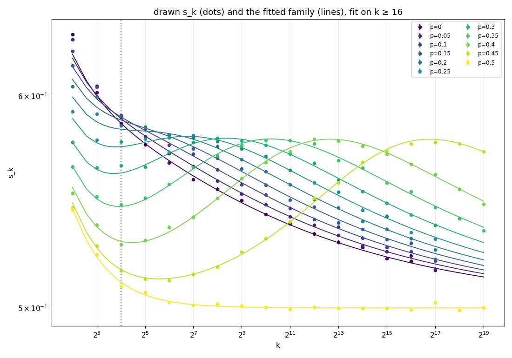

# A family of functions for the `n4e6` local slopes (2026-10-08)

Descriptive fit of the drawn $s_k$ in `data/omega_n4e6.json` (figure `data/log_slopes_n4e6.png`),
all 11 values of $p$ at once. It is not an estimator. It assumes the limit $\tfrac12$
through the SRW baseline (tested below with a free offset).
Scripts: `fit3.py`, `fit4.py` in the job scratch dir `~/.claude/jobs/44c6c931/tmp/`, not in the repo.

## The family

With $\varepsilon=\lvert1-2p\rvert$ (the probability that the walker reads its site,
`skip_read`) and $x=k/k^*(\varepsilon)$:

$$
s_k(p) = s_k^{\rm SRW} + A\,\frac{x^{\beta}}{(1+x^{\eta})^{(\beta+\omega)/\eta}},
\qquad
k^*(\varepsilon) = c\,\varepsilon^{-a}\,(1-\varepsilon^2/2)^{g}.
$$

- $s_k^{\rm SRW}=\log_2\big(\mathbb E\lvert S_{2k}\rvert/\mathbb E\lvert S_k\rvert\big)$ with
  $\mathbb E\lvert S_{2m}\rvert = 2m\binom{2m}{m}4^{-m}$: exact, no parameters. At $p=\tfrac12$
  the walk is srw. The drawn $p=\tfrac12$ slopes match it: $\chi^2=22.5$ for 18 points.
- The hump rises as $x^\beta$, peaks near $k^*$ and decays as $x^{-\omega}$. Its height is the
  same for every $p$: the excess over $p=\tfrac12$ peaks at about 0.078 for $p\ge0.15$.
  Small $p$ has $k^*$ of a few steps, so only the decaying tail shows.

## Fit (GLS, $k\ge16$, 146 points, 7 parameters)

The covariance comes from `sigma_log`: neighbouring $s_k$ share a scale, so
$\mathrm{Cov}(s_k,s_{2k})=-\sigma_{\log,2k}^2/\ln^2 2$.

| parameter | value |
|---|---|
| $A$ | 0.1426 ± 0.0013 |
| $\beta$ (rise) | 0.433 ± 0.004 |
| $\omega$ (tail) | 0.184 ± 0.001 |
| $\eta$ (sharpness) | 0.624 ± 0.007 |
| $\ln c$ | 0.83 ± 0.03 ($c\approx2.3$) |
| $a$ | 4.09 ± 0.006 |
| $g$ | 0.71 ± 0.01 |

$\chi^2/\text{dof}=681/139=4.9$. Mid-range residuals are mostly within ±2σ. The shape is
right but not exact at ±0.0008 per $s_k$.

- **Free offset** (limit $\tfrac12+\delta$): $\delta=-0.0017\pm0.0008$, $\chi^2$ 677/138. No
  gain, so the data agree with the limit $\tfrac12$.
- **Small $k$:** $k=4,8$ miss by up to 13σ at small $p$, a lattice term the scaling form
  lacks. On $k\ge4$, $\chi^2/\text{dof}=21$.
- **Fixed-$p$ $\omega$:** the implied value is about 0.18, reached only for $k\gg k^*$. For
  $p\ge0.35$ that is beyond $2^{20}$, which is why the README's tail fits wander there.

## Alternatives tried

| variant | $\chi^2/\text{dof}$ |
|---|---|
| hump above, $k^*=c\,\varepsilon^{-a}(1-\varepsilon^2/2)^g$ | **4.9** ($k\ge16$) |
| hump above, $k^*=c\,(\varepsilon^{-1}-b)^{a}$; $a=3.93$, $b=0.20$ | 5.9 ($k\ge16$) |
| hump above, $k^*=c\,\varepsilon^{-a}$; $a=4.30$ | 22.9 ($k\ge16$) |
| hump above, $k^*=c\,\varepsilon^{-4}$ fixed | worse than free $a$ |
| $k^*$ free per $p$, rational hump | 11.4 (all $k$, baseline: drawn $p=\tfrac12$) |
| $k^*$ free per $p$, rise $x^\beta/(1+x^\beta)$, tail $(1+c\ln(1+x))^{-m}$ | 11.4 (same) |
| $k^*$ free per $p$, Gaussian in $\ln k$ with different left and right widths | 42 (same) |

The rational and log tails fit equally well: $k\le2^{19}$ cannot tell $x^{-0.18}$ from a
slow logarithmic decay. Free $\log_2k^*$ (rational hump): 0.55, 1.34, 2.17, 3.04, 4.02,
5.15, 6.51, 8.29, 10.78, 14.86 for $p=0,0.05,\dots,0.45$.

