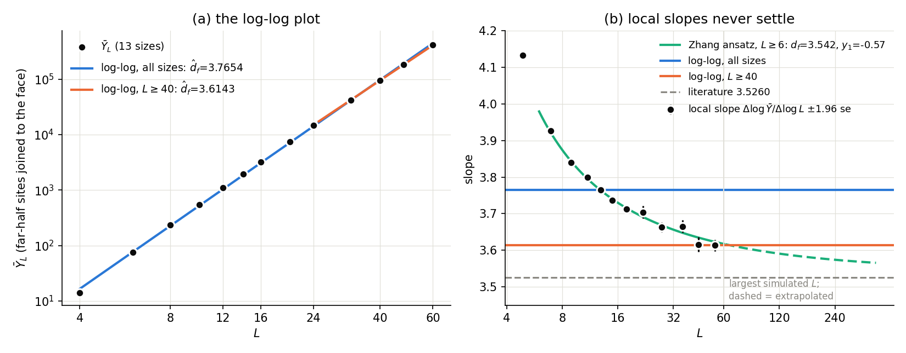

# Experiment 43 — Zhang et al. 2020's allocations for $d_f$, $d=4$ and $5$, with the log-log estimator

Part of `plans/literature_fss_protocols.md` (arm B, and D3, the reproduction check).
**Status: step 1 (D3) run 2026-10-27 — the reproduction check FAILS for the log-log
estimator; step 2 not run, and not worth running as designed (see below).**

## Question

Zhang, Hou, Fang, Hu & Deng, arXiv:2004.11289 (2020), are the source of this repo's
acceptance values $d_f(4)=3.0446(7)$ and $d_f(5)=3.5260(14)$. Their allocation (Sec. II):

- 4D: *"L = 4, 6, 8, 10, 12, 14, 16, 20, 24, 32, 40, 48, 64, 96, 128, 176, 192, and the
  numbers of independent samples are more than 10⁶ for each L ≤ 64 and at least 10⁵ for
  each L > 64"*;
- 5D: *"more than 10⁶ samples are taken for each of L = 4, 6, 8, 10, 12, 14, 16, 20, and
  at least 10⁵ samples for each of L = 24, 32, 40, 48, 60"*.

The recipes use the stated minima, $10^6$ and $10^5$. Arm B draws these allocations on
this repo's sampler and estimates $d_f$ with the article's log-log regression, exactly
as in experiment 42 (`full` and `window` slopes, finite-m standard error, $\pm1.96$ se).

Differences from the paper, by design: site percolation with `face_far` on a cylinder,
not bond percolation with the largest cluster on a periodic box. **The 4D list is
truncated at $L=128$**: $176^4$ and $192^4$ exceed the int32 label space of
`percolation_zd_gpu`, and those two sizes carry about 80% of the published 4D budget.
So only the 5D recipe is the published allocation.

## Known values — acceptance criteria, not inputs (ground rule 4)

- $d_f(4)=3.0446(7)$, $d_f(5)=3.5260(14)$ (this paper; bond percolation, same universality class).

## Cost

| recipe | sizes | cost units / replicate | GPU time / replicate (4.1·10⁹ sites/s) | top rung share |
|---|---|---|---|---|
| `protocol_zhang2020_d5.json` | 13, $L=4..60$ | $1.23\cdot10^{14}$ | ≈ 8.3 h | 63% |
| `protocol_zhang2020_d4_truncated.json` | 15, $L=4..128$ | $6.2\cdot10^{13}$ | ≈ 4.2 h | 44% |

## Step 1 — D3, reproduction check (user, 2026-10-26: yes)

One replicate of the 5D recipe. It checks that the published allocation, on our
sampler, gives an estimate consistent with 3.5260 before it is used as a baseline.

```bash
python3 src/budget/protocol_arm.py -meta experiments/43_lit_zhang2020_df_d4_d5/recipes/protocol_zhang2020_d5.json \
    --tag zhang2020_d5 --replicates 1
```

## Step 2 — arm B against arm A

$R=5$ replicates of each recipe, then `autopilot.py` with `--time` equal to arm B's
measured wall clock per replicate, scored on the same truth.

## Step 1 — result (2026-10-27, purus, seed 2026102643, 30 643 s = 8.5 h)

| estimator | sizes used | $\hat d_f$ | $\pm1.96$ se | error vs 3.5260 | error / se |
|---|---|---|---|---|---|
| log-log, all 13 sizes (`full`) | 4..60 | 3.7654 | 0.0008 | +0.239 | +606 |
| log-log, χ² window (`window`, $L_{\min}=40$) | 40, 48, 60 | 3.6143 | 0.0089 | +0.088 | +19 |

Local slopes $\Delta\log\bar Y/\Delta\log L$ never level off:

```
4-6 4.132   6-8 3.927   8-10 3.839   10-12 3.799   12-14 3.765   14-16 3.736
16-20 3.712   20-24 3.704   24-32 3.663   32-40 3.665   40-48 3.616   48-60 3.613   (±0.003..0.010)
```



*(a) On the log-log plot the 13 means look like a straight line, and the all-size fit
($\hat d_f=3.765$) and the $L\ge40$ fit (3.614) are hard to tell apart by eye. (b) The
local slopes show the curvature that (a) hides. Zhang's ansatz fitted on $L\ge6$ (green)
follows them and still sits at 3.57 at $L=240$, four times the largest simulated size.*

The last pair is still 0.087 above the literature value and falling. **D3 fails: on
this observable, Zhang et al.'s allocation does not give $d_f(5)$ through a log-log
slope.** The full fit's interval is 0.0008 wide and 0.24 off. At $10^5$–$10^6$ samples
per size the noise is negligible and the error is all finite-size bias, which the
$\pm1.96$ se interval does not contain (it omits eq. (720)'s $\mathcal B_{\text{fs}}$).
This repeats experiment 30 ($d=5$, `face_far`, 4..64: 3.7851) at a far larger budget.

### Zhang et al. do not use a log-log plot

Their estimator (Sec. II, eq. (5)) is a weighted least-squares fit of the
finite-size-scaling ansatz $O = c_0 + L^{d_O}(a_0 + a_1 L^{y_1} + \dots)$, with:

- $y_1$ first free, then fixed. A subleading $a_2L^{y_2}$ is added when one correction
  does not fit.
- A cutoff $L\ge L_m$, raised until χ² is reasonable and the estimate stable.
- An error bar that adds the spread over $L_m$ and $y_1$ to the statistical one.

The log-log slope is the special case $c_0=a_1=0$.

Their observable is also different: $C_1$, the mean largest cluster, in *bond*
percolation on a *periodic* box. Its leading correction is fast, $y_1=-2.0(2)$, and their 5D fits are
accepted from $L_m=6$ (Table II: 3.5264(10) with $y_1$ free; 3.5257(3) and 3.5260(5) with
$y_1=-2$).

Refitting **our** $\bar Y$ with their ansatz (`diagnose_d5.py`, same χ² rule as
`tools/lmin_rule.py`):

| ansatz | $L_m$ | $\hat d_f$ | correction exponent | χ²/DF | error vs 3.5260 |
|---|---|---|---|---|---|
| Zhang eq. (5), $y_1$ free | 4 | 3.5739(46) | $y_1=-0.77(3)$ | 29.5/9 rejected | +0.048 |
| | **6** | **3.5424(127)** | $y_1=-0.57(6)$ | 15.3/8 | +0.016 (1.3 se) |
| | 8 | 3.5166(309) | $y_1=-0.44(13)$ | 13.7/7 | −0.009 (0.3 se) |
| | ≥ 12 | unidentified | $y_1\to0$, se ≫ 1 | | |
| Zhang eq. (5), $y_1=-2$ fixed | 20 | 3.6033(46) | — | 8.3/3 | +0.077 |
| article eq. (232), $J=1$ | 10 | 3.5538(214) | $\omega_1=0.80(12)$ | 15.0/6 rejected | +0.028 |
| | 12 | 3.4612(914) | $\omega_1=0.46(19)$ | 10.5/5 | −0.065 |

Fixing $y_1$ (to leading order $y_1=-\omega_1$: $\log[L^{d_f}(a_0+a_1L^{y_1})] =
\log a_0 + d_f\log L + (a_1/a_0)L^{y_1} + O(L^{2y_1})$, which is eq. (232) with $J=1$),
at the first $L_m$ that passes the χ² rule:

| fixed $y_1$ | $L_m$ | $\hat d_f$ | error vs 3.5260 |
|---|---|---|---|
| −0.44, −0.57 (our free fits) | 8, 6 | 3.5156(17), 3.5418(12) | −0.010, +0.016 |
| **−0.72 (universal 5D ω, experiment 30 README)** | 20 | **3.5358(89)** | +0.010 (1.1 se) |
| −0.96, −1.0 | 20 | 3.5594(76), 3.5625(74) | +0.033, +0.037 |
| −1.35 (experiment 30's pilot $\omega_1$) | 20 | 3.5829(60) | +0.057 |
| **−2 (Zhang's value for $C_1$)** | 32 | **3.5671(143)** | +0.041 (2.9 se) |

The answer moves by ±0.03 across plausible $y_1$, far more than any fixed-$y_1$ se. That
is why Zhang add the spread over $y_1$ to their error bar. Their $y_1$ is an effective
exponent for each observable: in their 5D tables it is −2 for $C_1$, −2.4 for $C_{lf}$,
−1.7 for $\chi'$ and −0.4(3) for $Q_s$.

So **the data are consistent with $d_f=3.526$**: their estimator applied to our data
recovers it within 1.3 se. **The observable and the sampler are fine.** The failure
belongs to the log-log estimator on an observable whose leading correction is large,
$a_1/a_0\approx-1.1$ to $-1.2$, and slow, $\omega_1\approx0.4$–$0.6$: still 12–18% of $\bar Y$ at
$L=60$. This is not Zhang's $C_1$, where the correction is $L^{-2}$. Their fixed
$y_1=-2$, imported, is wrong for our observable. It never fits below $L_m=20$, and it
leaves +0.077.

### The article's assumptions on this run

| assumption | verdict | evidence |
|---|---|---|
| 1, expansion eq. (232) | **holds only formally; $J=1$ is not adequate on $L\le60$** | The fitted $\omega_1$ drifts with the cutoff: 1.25 → 0.99 → 0.85 → 0.80 → 0.46 for $L_m$ = 4, 6, 8, 10, 12, and the χ² is rejected until $L_m=12$. A single correction with a constant exponent does not describe the data, so several terms of comparable size are active. Experiment 30's pilot (4..64) measured $\omega_1=1.35(16)$, a value from the fast early curvature. |
| 2, $Y_i>0$ | fails per sample, by design; harmless here | `face_far` gives $Y=0$ with O(1) probability (`models/percolation_zd.py`, `percolation_zd_gpu` docstring). Every $\bar Y$ is positive at $n\ge10^5$. |
| 3, $\lvert\phi_j\rvert\le\phi^+$ | not testable from one replicate | $\phi^+$ is unknown, which is why eq. (720)'s $\omega_2$ piece is omitted throughout the repo. |
| 4, $(2+\delta)$-moment of $\xi_k-1$ | consistent | $cv^2=\operatorname{Var}Y/(\mathbb EY)^2$ is finite at every size (1.11 at $L=4$, 0.16 at $L=60$). Only mean and variance are stored, so moments above 2 are not checked. |
| 5, $(2+\delta)$-moment of $\log\xi_k$ | **depends on how eq. (305)/(319) define $\xi_k$** | With $\xi_k$ a single sample over its mean, $\log\xi_k=-\infty$ with O(1) probability, and the assumption fails. With $\xi_k=\bar Y/\mathbb EY$ it holds. This needs `article.tex`, which is not on this host. |
| 6, $\sigma_k^2\to\sigma_\infty^2$ | holds, slowly | $cv^2$: 0.199, 0.182, 0.171, 0.162 at $L$ = 32, 40, 48, 60. An unweighted fit $s_\infty+bL^{-w}$ gives $s_\infty=0.157(6)$, $w=1.5$. The se uses the measured $cv^2$ per size, so a slow approach does not bias the interval. |
| 7, $cost=L^d$ | **fails above $L\approx32$** | 0.12–0.13 ns/site on $L$ = 8..24, then 0.165, 0.246, 0.257 and 0.261 at $L$ = 32, 40, 48, 60. The cost exponent over $L\ge8$ is 5.41, not 5. This is the doubling past ~10⁸ sites per sample found in experiment 24 ($40^5=1.02\cdot10^8$). It affects the allocation, not $\hat d_f$. |

What follows for the theorems:

- With $\omega_1\approx0.5$ and $d=5$, eq. (941)'s rate is $B^{-\omega_1/(d+2\omega_1)}=B^{-1/12}$.
  Halving the error costs $2^{12}\approx4000\times$ the budget.
- Prop. (820)'s $\mathcal B_{\text{fs}}\asymp\rho^{-\omega_1m_0}/m^2$ is the whole error
  here. The theorem therefore predicts this failure; the run does not contradict it. The
  defect is in the reported interval, $\pm1.96$ se without $\mathcal B_{\text{fs}}$.

## Consequence for step 2

Racing `autopilot.py` against this allocation at 8.5 h would compare two log-log
estimates that share the same 0.09+ bias. Neither would cover. The race would measure
the observable's corrections, not the allocation rule. **Step 2 is not run as designed.**
A fair 5D comparison would need an observable with corrections like $C_1$'s, i.e.
Zhang's own observable, which `percolation_zd_gpu` does not implement.

```bash
.venv/bin/python experiments/43_lit_zhang2020_df_d4_d5/diagnose_d5.py \
    experiments/43_lit_zhang2020_df_d4_d5/data/zhang2020_d5
```
