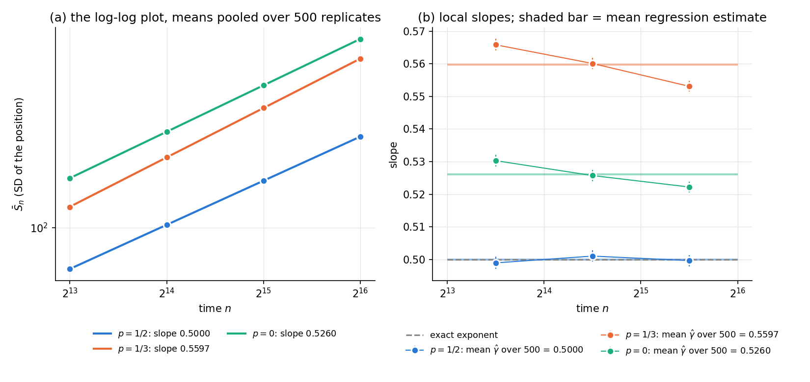

# Experiment 44 — Avena & Thomann 2012's allocation for `rwre`, with the log-log estimator

Part of `plans/literature_fss_protocols.md` (arm B, user, 2026-10-26). **Status: arm B
done (2026-10-26, xingu, 500 replicates per point); arm A's design open.** On the
published allocation, the log-log regression over the four times is unbiased at the
control and covers 95.2%; the published single-point estimator is off by exactly its
amplitude term $\log c/\log n$, 23 times its own spread.

## Question

Avena & Thomann, *J. Stat. Phys.* 147, 1041 (2012), arXiv:1201.2890, simulate a random
walk on the simple symmetric exclusion process and estimate its scaling exponent
(their Fig. 17, a grid over $(p,\gamma)$ at density $\rho=1/2$). Their protocol (Sec. 3.3):
times $n=2^N$, independent samples at each $n$, $M$ of order $10^3$ ("the values of M are
specified in the figures"), and the single-point estimator

$$\alpha(n)=\frac{\log\mathrm{SD}_n}{\log n},\qquad \alpha^\star=\alpha(n_{\max}),$$

which they note carries a $\log c/\log n$ amplitude bias, and which comes with no error
bar. Their Fig. 19 shows $n=2^{13}..2^{16}$ with $M=4712, 6120, 6120, 6120$.

Arm B draws that allocation on `rwre_gpu_lazy` and reports, per replicate, three
estimates (`src/budget/protocol_arm.py`): the log-log OLS slope over the four times
(`full`), the same over the $\chi^2$-chosen window (`window`), each with the finite-m
standard error, and their single-point estimator (`single_point`) on the same draws.
On a $2^N$ grid with near-uniform $M$ this is the closest any published protocol comes
to the article's setting.

## Points

| recipe | our $p$ | their $p$ | truth | why |
|---|---|---|---|---|
| `protocol_avena_thomann_p0.5.json` | 1/2 | 1/2 | $\gamma=1/2$ exactly (the walk is a simple random walk) | the control: coverage is measurable |
| `protocol_avena_thomann_p0.333.json` | 1/3 | 2/3 | none known | experiment 02's headline point |
| `protocol_avena_thomann_p0.json` | 0 | 1 | none known | the trapping end; experiments 19 and 41 measured it on ladders to $2^{20}$ |

Density 1/2 and environment rate $\gamma_{\rm eff}=1$ (`rwre_gpu_lazy` defaults; the
mapping to their $\gamma$ is in `models/rwre.py`). Their $p$ is $1-$ ours. $R=500$
replicates per point, about 1 s each.

Assumptions, stated: the pairing of Fig. 19's four $M$ values with the four times is
taken in increasing $n$ (the legend does not say). Our observable is $\mathbb E|X_n|$,
theirs $\mathrm{SD}(X_n-v_nn)$; at density 1/2 $v=0$ and both carry the same exponent,
with different amplitudes, so the single-point estimator's amplitude bias differs too.

## Known values — acceptance criteria, not inputs (ground rule 4)

- $p=1/2$: $\gamma=1/2$ (simple random walk).
- $p=1/3$, $p=0$: no proven value. Their Fig. 17 at $\gamma\approx1$ reads $\alpha^\star\approx0.54$–$0.57$
  across $p$ (their convention); experiment 02 measured a maximum at an interior $p$.
  These are comparisons, not truths.

## Commands

```bash
bash experiments/44_lit_avena_thomann2012_rwre/run_arm_b.sh   # 44 then 45, one idle host
```

Run 2026-10-26 on xingu (idle when started: GPU 0%, load 0.26), seeds 202610264400–2,
7.4–8.4 min per point (about 1 s per replicate). Logs: `data/avena_thomann_*.log`;
artifacts: `data/avena_thomann_*/protocol_arm.json`.

## Result — arm B (2026-10-26)



*(a) The log-log plot of the means pooled over the 500 replicates. (b) Local slopes. At
$p=\tfrac12$ the slopes are flat at 0.5000. At $p=\tfrac13$ and $p=0$ they still fall
across $2^{13}..2^{16}$ (0.566 → 0.553 and 0.530 → 0.522), so neither estimate has
settled. Drawn by `experiments/plot_lit_walks.py`.*

Means and spreads over $R=500$ independent replicates of the published allocation.

| $p$ (ours) | `full`: mean ± sd | mean finite-m se | `window`: mean ± sd | `single_point`: mean ± sd |
|---|---|---|---|---|
| 1/2 (truth 1/2) | **0.5000** ± 0.0064 | 0.0066 | 0.5000 ± 0.0088 | **0.4796** ± 0.0009 |
| 1/3 | 0.5597 ± 0.0062 | 0.0064 | 0.5578 ± 0.0080 | 0.5347 ± 0.0008 |
| 0 | 0.5260 ± 0.0066 | 0.0065 | 0.5247 ± 0.0091 | 0.5487 ± 0.0009 |

**At the control ($p=1/2$, $\gamma=1/2$):**

| estimate | bias | RMSE | coverage of $\pm1.96$ se |
|---|---|---|---|
| `full` | $-0.00002$ | 0.0064 | **476/500 = 95.2%** |
| `window` | $+0.00001$ | 0.0088 | 453/492 = 92.1% (8 replicates: no acceptable $L_{\min}$) |
| `single_point` | $\mathbf{-0.0204}$ | 0.0204 | no error bar |

Readings:

1. **The finite-m standard error is right.** Predicted 0.0066, observed sd 0.0064, and
   coverage 95.2% at the control. With the bias negligible at these times, the
   statistical interval alone is honest here.
2. **The single-point estimator's bias is exactly its amplitude term.** For a simple
   random walk $\mathbb E|X_n|\to c\sqrt n$ with $c=\sqrt{2/\pi}$, so
   $\alpha(n)-\tfrac12\to\log c/\log n=-0.2258/11.09=-0.0204$ at $n=2^{16}$. Measured:
   $-0.0204$. That is 23 times the estimator's own spread (0.0009): its precision is
   illusory. Its sign follows $\log c$, so it flips between points: below `full` at
   $p=1/3$ ($-0.025$), above it at $p=0$ ($+0.023$). That is the sign flip experiment 02
   found from the other side, and it is enough to change the shape of their Fig. 17.
3. **The $\chi^2$ window costs, here.** Choosing $L_{\min}$ from the data is a
   post-selection step: coverage falls to 92.1% and the RMSE rises 37%, with no bias to
   remove at these times.
4. **Without a truth ($p=1/3$, $0$),** `full` gives $0.5597\pm0.0062$ and $0.5260\pm0.0066$
   per replicate. For $p=0$, experiment 41's long ladder ($2^{19}..2^{24}$) gives
   $0.5061$ and 19's ($2^{15}..2^{20}$) $0.5180$: the published times $2^{13}..2^{16}$ sit
   higher on the same slow ($\omega\approx0.15$) drift towards 1/2, so the precision is
   real but the finite-time bias, which no interval here prices, is not small.
