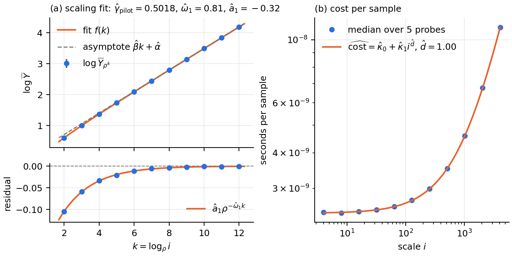
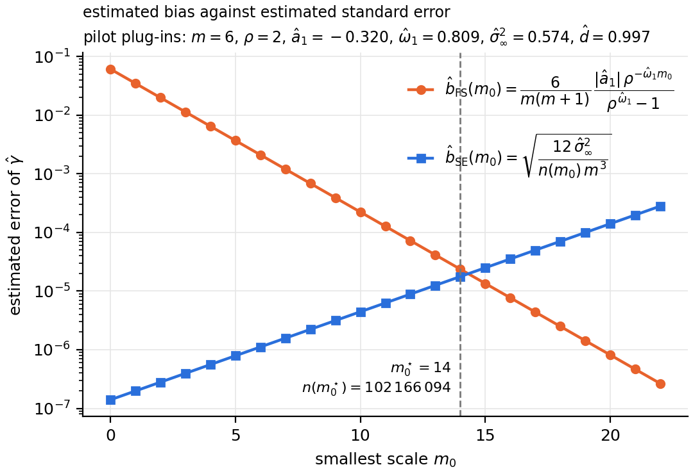
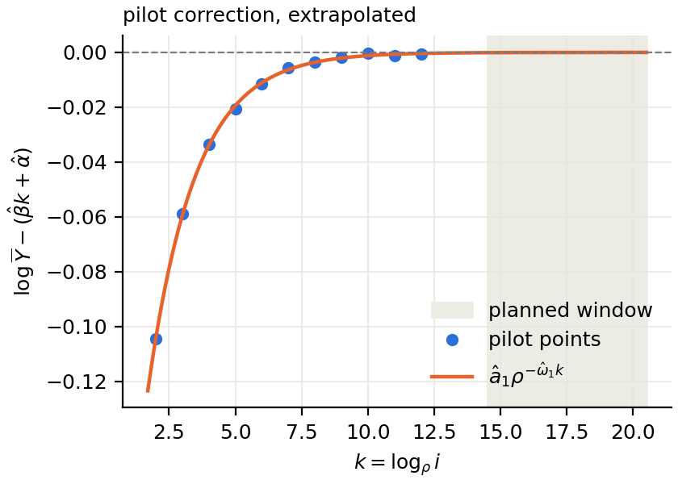
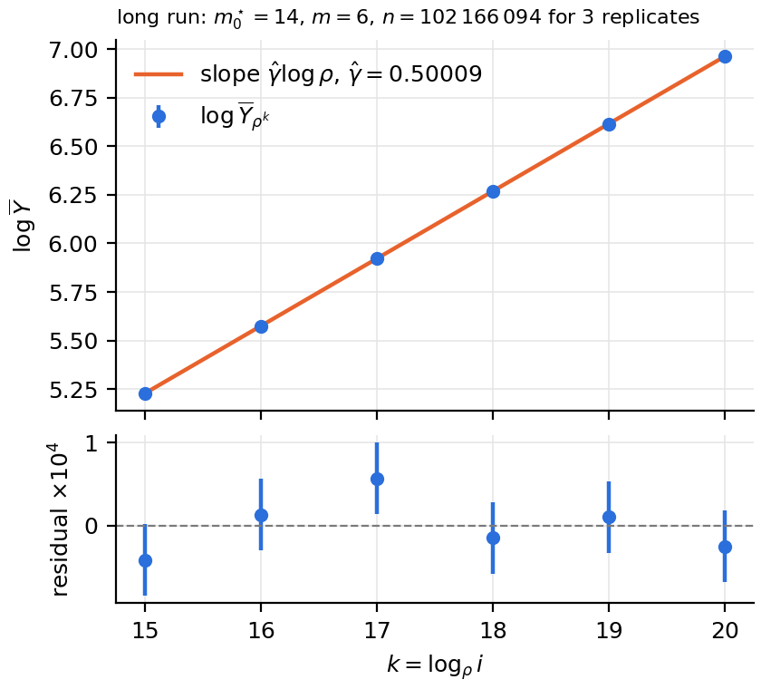
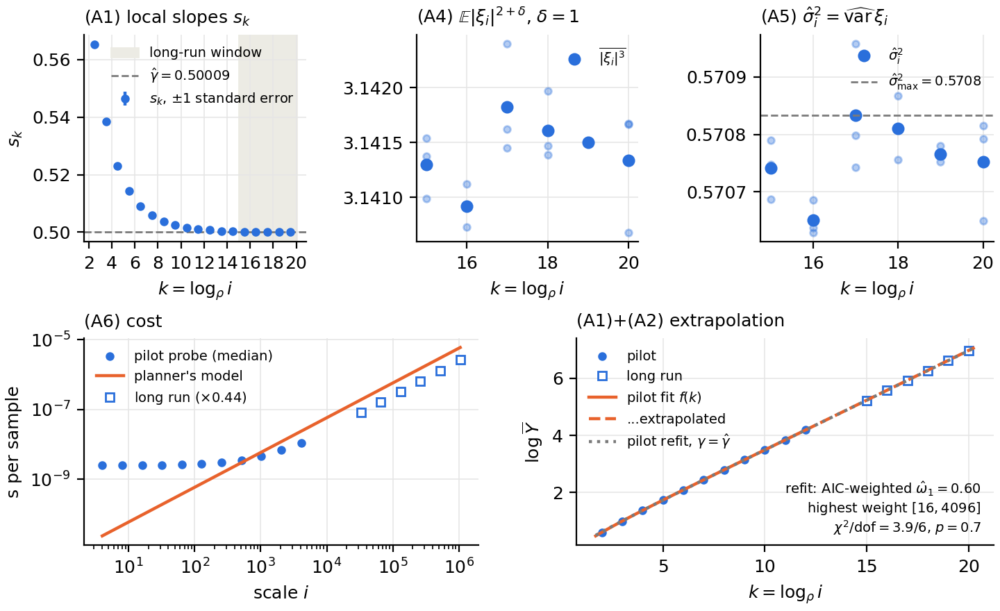

# Experiment 46 — the four-step pipeline on `erw_urn_gpu`, as the article's worked example

**Question (user, 2026-10-28).** The article's Section "Simulations" describes the
pipeline: pilot, budget allocation, long run, then assumption checks and estimate.
It needs one figure per step from a single real run. This experiment is that run.
It's an illustration, not a test of a new claim. The ERW's model, regimes and truths
are in `experiments/11_erw/README.md`, and the sampler is described in
`experiments/14_erw_urn_gpu/README.md`.

## Setup

| | |
|---|---|
| model | `erw_urn_gpu`, $p = 0.6$ (diffusive), $Y_i = \lvert S_i\rvert$ |
| pilot recipe | `recipes/samples_pipeline_p0.6.json`: 14's pilot template, scales $4..4096$ |
| budget | `autopilot.py --time 1h --replicates 3 --max-scale 268435456` |
| ceiling | `--max-scale` from 14's `sweep_p.py` rule (full device at $n \ge 261{,}120$), computed for 1 h |
| host | missouri, RTX 5090, 2026-10-29. Not purus: its GPU also drives the user's desktop (CloudCompare), which disturbed probes. Not niagara: another project uses its GPU every ~10 min (user, 2026-10-29) |

### What the Step 4 checks needed (user, 2026-10-28)

A long run keeps per-scale summaries, not draws. The article's (A3) and (A4) checks
need two expectations over individual draws that the summary didn't keep. So
`tools/summary.py` gained `abs_moment` ($\overline{\lvert\xi_i\rvert^{3}}$) and
`n_nonpos` (draws $\le 0$). Older artifacts don't have them.

### The cost probe was reading whole GPU waves (fixed 2026-10-29)

The first run (`data/pipeline_p0.6_1h`, seed 20261029) drew a pilot cost panel with
jumps. `probe_batched` reads the marginal cost $(t(4n)-t(n))/3n$, and its walk picks
$n$ anew at each scale. On this card one wave is 261,120 samples. At $n=131{,}072$,
$4n=524{,}288$ is two waves plus 2,048 samples, and the marginal cost read ~3× high:

| n the walk picked | marginal cost at small scales |
|---|---|
| 131,072 | 4.0e-9 s, every time |
| 65,536 or 32,768 | 1.2–1.8e-9 s, smooth in $i$ |

Which one the walk lands on is close to random, so $\hat d$ went from 0.96 to 1.75
between probes on one machine, with relative RMSE ~0.4. A second attempt (`_v2`,
seed 20261030) planned on $\hat d = 1.50 \pm 0.13$ and was stopped before its long run.

Fix: `ModelSpec.device_fill` (only `erw_urn_gpu` declares it, as `resident_threads`)
makes `probe_batched` round $n$ up to whole waves (`tools/cost_model.py`,
`_whole_waves`). Eight probes then gave $\hat d = 0.98$–$1.03$, relative RMSE ≤ 0.03.
`src/study/pilot.py` now also keeps every probe (`cost.probes`), not only the last.
The two `rwre` GPU models, which run one block or warp per sample, still use the old
walk. Their past probes may carry the same bias, and nobody has checked yet.

## Commands

```bash
D=experiments/46_pipeline_erwurn_gpu/data
python3 -u src/study/autopilot.py -meta experiments/46_pipeline_erwurn_gpu/recipes/samples_pipeline_p0.6.json \
    --study pipeline_p0.6_1h_missouri --data-root $D --time 1h --replicates 3 --seed 20261102 \
    --max-scale 268435456 --no-progress > $D/pipeline_p0.6_1h_v3.log 2>&1
python3 experiments/46_pipeline_erwurn_gpu/plot_pipeline.py --study $D/pipeline_p0.6_1h_missouri
```

## Result (`pipeline_p0.6_1h_missouri`, 2026-10-29)

Launched over ssh on missouri (shared home, same checkout), under `nohup`.

| step | outcome |
|---|---|
| pilot | 3 × 488,519 samples per scale. $\hat\gamma_{\rm pilot}=0.5018$, $\hat\omega_1=0.809\pm0.005$, $\hat a_1=-0.320$, $\hat d=0.997\pm0.010$ (5 probes, all clean: 0.96–1.02) |
| plan | $m_0^\star=14$, $m=6$ (scales $2^{15}..2^{20}$), $n=102{,}166{,}094$, predicted bias $1.8\times10^{-5}$, sd $2.6\times10^{-5}$ per replicate |
| long run | 3 replicates, 1577 s, 0.44× the plan's 3595 s |
| estimate | $\hat\gamma=0.50009$, eq:wilson 95% $[0.49994, 0.50025]$, half-width $1.54\times10^{-4}$ ($B_{fs}=1.04\times10^{-4}$, $1.96\sigma_{se}=5.1\times10^{-5}$, $B_{good}=7\times10^{-9}$; without the $\omega_2$ piece). Contains 1/2. With the pre-2026-11-04 four-term bound: $[0.49992, 0.50026]$. Before 2026-11-02, with the plan's $\omega_1=0.809$ in $B_{fs}$: $[0.49999, 0.50019]$ |
| pilot refit, $\gamma$ pinned to $\hat\gamma$ | $\omega_1=0.707\pm0.009$, $a_1=-0.304$, the $\omega_1,a_1$ of $B_{fs}=1.0\times10^{-4}$. $\chi^2=31.9$ on 8 dof, p = 1e-4: **warning** (one correction does not explain the pilot around $\hat\gamma$) |
| replicate-$t$ | $[0.50004, 0.50014]$: scatter only, **excludes** 1/2 (bias ≈ $1\times10^{-4}$) |







Readings:

1. **The cost probe is clean on an idle card:** five probes agree within a few percent
   at every scale (one ran 4–10% slow above $i=16$). The panel draws only their per-scale
   median, with one fit of eq. (cost) to it ($\hat d=1.00$). The planner uses the mean of the five probes' own
   exponents.
2. **(A3) fails for $\lvert S_i\rvert$:** zeros at even $i$, fraction $3.4\times10^{-3}$ at
   $2^{15}$ down to $6.0\times10^{-4}$ at $2^{20}$ (ratio 5.7 over a factor 32, i.e. $\approx i^{-1/2}$).
3. **(A4) is flat** at $\overline{\lvert\xi\rvert^3}=3.1414\pm0.0005$, which is the half-normal
   value $\pi$. **(A5) is flat** at $\hat\sigma^2=0.5708$, the half-normal value $\pi/2-1$.
4. The log-moment panel ($\overline{\lvert\log\xi\rvert^3}$, still rising 3.00 → 3.59) is
   gone: the 2026-11-04 article revision dropped that assumption and the Wilson term that
   used it (user). Panels are labelled as in the article's Step 4 list since then.
5. **(A6):** the long run took 0.44× the plan's time. The throughput measured on the
   pilot's small scales understates the one at the long run's scales, as in 14.
6. **(A1)+(A2):** the pilot fit, extrapolated, follows the long-run points on the
   log-log plot and is off by at most $9.9\times10^{-3}$ in $\log\overline Y$ at
   $2^{20}$. That's mostly $\hat\gamma_{\rm pilot}$, $1.7\times10^{-3}$ high. The three
   per-replicate pilot fits agree to $10^{-4}$ (0.50170–0.50182, gaps 9.5–10.1e-3), so
   this is **systematic**: the four-parameter fit on 4..4096 doesn't extrapolate $\gamma$.
   Experiment 17's two-correction picture would account for it, but that's untested here.
   Across runs the pilot read 0.5010 (purus, first), 0.5014 (purus, v3), 0.5009
   (niagara, stopped) and 0.5018 (here). The pilot placed the window anyway:
   $\hat b_{\rm FS}$ and $\hat b_{\rm SE}$ cross at 14 in every run.
7. **The allocation figure plots estimates, not measurements (user, 2026-11-02).** It draws
   the article's eqs. (bFS) and (bSE) with the pilot's $\hat a_1$, $\hat\omega_1$,
   $\hat\sigma^2_\infty$ plugged in. Only their crossing $m_0^\star$ is used. These are not
   `plan.py`'s internal constants (`tools/allocation.py` keeps the exact weight sums and
   a $1/\log\rho$): at every $m_0$ the article's bias is 1.30× and its SE $\log 2=0.69$× the
   planner's (0.68× before the article's SE carried the exact $m(m^2-1)$, 2026-11-04). Both give $m_0^\star=14$, and `plot_pipeline.py` asserts that. The pilot
   correction's extrapolation is now its own figure.

Figures were copied to `images/` here (PNG) and to `../article_writting/images/` (PDF, for the article on Overleaf).

### Superseded runs (in `data/`, gitignored)

| study | host | why superseded |
|---|---|---|
| `pipeline_p0.6_1h` | purus | finished. One of its five probes hit the wave bug, and only that one was stored |
| `pipeline_p0.6_1h_v2` | purus | stopped after its pilot: planned on $\hat d=1.50$ from the wave bug |
| `pipeline_p0.6_1h_v3` | purus | finished ($\hat\gamma=0.50011$). One probe disturbed by desktop GPU use |
| `pipeline_p0.6_1h_niagara` | niagara | stopped in its long run: another project shares that GPU |

## Wilson interval with the AIC pilot refit (2026-11-07)

B_fs now takes $\omega_1, a_1$ from the pilot refitted with $\gamma$ pinned to $\hat\gamma$ on a range of
$\ge 5$ consecutive pilot scales chosen by AIC with data cuts (Jay & Neil 2021;
`local_slope.omega_ranges`, `report.pinned_refit`), not on every pilot scale as in the
2026-11-02 refit. $\hat\gamma$ is unchanged; only the eq. (720) half-width moves. The
$\omega_1$ error is the profile error $\oplus$ the spread over ranges. Old = all-scales pinned
refit (kept in `answer.json` as `pilot_refit_all_scales`), new = AIC refit (`pilot_refit`);
reports rerun 2026-11-07. A warning is $\chi^2$ $p < 0.01$ (old: or $\omega_1$ on its bound). ✓/✗: the interval contains / misses the exact $\gamma$.

| study | $\hat\gamma$ | old $\hat\omega_1$ | old $\chi^2$/dof | old radius | new $\hat\omega_1$ | range | new $\chi^2$/dof | new radius |
|---|---|---|---|---|---|---|---|---|
| `pipeline_p0.6_1h` | 0.500103 | 0.737 ± 0.0097 | 19.8/8 | 0.00013 ✓ | 0.689 ± 0.14 | 8..4096 | 8.01/7 | 0.000173 ✓ |
| `pipeline_p0.6_1h_missouri` | 0.500093 | 0.707 ± 0.0095 | 31.9/8 ⚠ | 0.000154 ✓ | 0.59 ± 0.057 | 16..4096 | 3.88/6 | 0.000349 ✓ |
| `pipeline_p0.6_1h_v3` | 0.500106 | 0.7 ± 0.0095 | 24.3/8 ⚠ | 0.000161 ✓ | 0.583 ± 0.085 | 32..4096 | 2.83/5 | 0.000352 ✓ |

Coverage of the exact $\gamma$: old 3/3, new 3/3.

`pipeline_p0.6_1h_missouri` is the article's worked example: its refit is now
$0.59 \pm 0.06$ on $16..4096$ (conjecture $|4p-3| = 0.6$), the interval
$[0.49974, 0.50044]$, and `images/pipeline_checks.png` (and the article's
`pipeline_checks.pdf`) draw this refit and name its range.

## Wilson interval with the AIC-weighted refit (2026-11-10)

$\omega_1$ is now the AIC-weighted average over the kept ranges (Jay & Neil 2021, eq. 15),
not the single highest-weight range; its error is their eq. (18). $a_1$ is refitted on the
highest-weight range with $\omega_1$ fixed at that average, so B_fs takes one coherent
$(a_1, \omega_1)$ (averaging $a_1$ separately pairs values from different fits). $\hat\gamma$
is unchanged; only B_fs and the eq. (720) half-width move.
Old = the 2026-11-07 highest-weight range, new = the average; reports rerun 2026-11-10.
"best" is the highest-weight range and its share of the kept weight; its $\chi^2$ still
gives the warning (⚠). ✓/✗: the interval contains / misses the exact $\gamma$.

| study | $\hat\gamma$ | old $\hat\omega_1$ | old radius | new $\hat\omega_1$ | best (weight) | new $\hat a_1$ | new $B_{\rm fs}$ | new radius |
|---|---|---|---|---|---|---|---|---|
| `pipeline_p0.6_1h` | 0.500103 | 0.689 | 0.000173 ✓ | 0.697 ± 0.18 | 8..4096 (0.16) | -0.29 | 0.000111 | 0.000164 ✓ |
| `pipeline_p0.6_1h_missouri` | 0.500093 | 0.59 | 0.000349 ✓ | 0.604 ± 0.0897 | 16..4096 (0.25) | -0.232 | 0.000263 | 0.000313 ✓ |
| `pipeline_p0.6_1h_v3` | 0.500106 | 0.583 | 0.000352 ✓ | 0.635 ± 0.102 | 32..4096 (0.16) | -0.247 | 0.000194 | 0.000244 ✓ |

Coverage of the exact $\gamma$: old 3/3, new 3/3.
