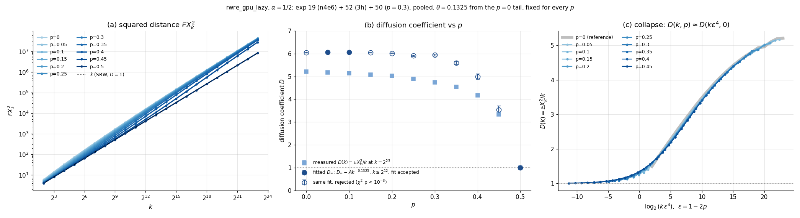

# Experiment 52 — the `rwre_gpu_lazy` pipeline across $p$, with $\omega_1$ fixed

**Status: launched 2026-11-04. No results yet.**

## Question (user, 2026-11-04)

Experiment 50 ran the article's pipeline at two values of $p$ only. What does the pipeline
($\hat\gamma$ by eq. (526), its eq. (720) bound, the Step 4 checks) give across the whole
range $p\in[0,\tfrac12]$, on one budget per $p$, when every plan rests on the same tail
correction ($\omega_1$, $a_1$ from 50's $p=0.04$ fit)?

## Acceptance criteria (known values, kept out of the code path)

- $p=\tfrac12$: nothing is ever revealed (`models/rwre_gpu_lazy.py`, skip-read), so the walk
  is srw and $\gamma=\tfrac12$ exactly. The 95% eq. (720) interval must contain ½.
  (srw's own correction is $\omega_1=1$, $a_1=-\tfrac14$, not the borrowed constants below,
  so at $p=\tfrac12$ the plan is built on a wrong correction by design.)
- Every other $p$: nothing proven. The article's conjecture is $\gamma=\tfrac12$ for all $p$.
  50's tail fits put $\gamma$ at 0.494–0.504 at $p=0.04$ and $0.3$.

## Design (decided by the user, 2026-11-04)

- **Model** `rwre_gpu_lazy`, observable $|X_i|$, params as 50's long runs: `alpha` 0.5,
  `kernel` "pool", `cap` 393216, defaults otherwise.
- **Grid:** 11 values $p = 0, 0.05, 0.1, \dots, 0.45, 0.5$.
- **Budget:** `--time 3h` per $p$, 5 replicates, `--max-scale 2^23` (as 50), $m=6$, $\rho=2$.
- **No pilot is drawn.** Each study reuses 19's `omega_p<p>_n4e6` ladder
  (`autopilot.py --reuse-pilot`; $n=800{,}000\times5$, 4..$2^{18}$ for $p\le0.3$,
  4..$2^{20}$ for $p\ge0.35$), as 50 did at $p=0.3$. Its constants are replaced
  (`build_constants.py`, every source in `constants.json`):

  | constant | at every $p$ | source |
  |---|---|---|
  | $\omega_1$ | $0.2552\pm0.0232$ | **borrowed** from 50 `pilot_p0.04_pool`: eq. (pilot-fit) on 48's local-slope $\ln\overline Y$, $\gamma$ free, $1024..2^{21}$ |
  | $a_1$ | $-1.0378\pm0.0497$ | **borrowed**, same fit |
  | cv | per $p$ | 19's ladder at that $p$, mean per-scale cv over its top 5 scales ($2^{14}..2^{18}$ or $2^{16}..2^{20}$). A moment, not a fit |
  | $d$, throughput | per $p$ | `time_window.py`: one call `simulate(i, 16384)` per scale $2^{18}..2^{23}$, pooled kernel, OLS in logs, on the host that draws the run |

- **Why $\omega_1$ and $a_1$ are not refitted per $p$ (user):** with $\omega_1$ fixed, a refit
  of $a_1$ does not work, because the per-$p$ ladders do not have the single-correction shape
  (19's hump). $d$ and the throughput are the only per-$p$ refit.
- **The cap and kernel note** (as 50): the built `pilot.json` carries the run's recipe
  (kernel "pool", cap 393216), although 19's draws were made with the warp kernel at cap
  $2^{15}$. Neither changes a draw. Recorded in `provenance_note`.
- **The cost block:** `pilot.json`'s `cost` is 19's own probe at that $p$ (4..$2^{16}$, warp
  kernel), for `plot_pipeline.py`'s panels only. 19's pilots predate the per-probe list
  `probes`, so it gets one entry (19's aggregated timing).

## Commands

```bash
# one p (time window, constants, autopilot, figures), all on the current host:
bash experiments/52_rwre_lazy_fixed_omega_sweep/run_p.sh <p> 3h <seed>
# the sweep: 11 lines in local/queue_52_sweep.txt, at most 4 hosts at once
nohup bash local/dispatch_pool.sh local/queue_52_sweep.txt > local/queue_52_sweep.nohup 2>&1 &
```

Each study writes `data/cost_window_p<p>_3h/`, `data/pilot_p<p>_3h/`, `data/fixed_p<p>_3h/`
and logs to `data/fixed_p<p>_3h.log`.

**Seeds:** run seed $202611045200 + k$, with $k$ the index of $p$ in the grid
($p=0$: …5200, $p=0.5$: …5210). The window timing's seed is the run seed $+20$
(…5220–…5230). The smoke test (`fixed_p0.3_smoke`, `TW_N=2048`, `--time 5m`) used
202611045206, the same root seed as the $p=0.3$ run (an oversight): its draws overlap that
run's streams, so the smoke study is a plumbing check only and is never combined with or
compared against `fixed_p0.3_3h`.

## Smoke test (2026-11-04, xingu, `fixed_p0.3_smoke`)

`TW_N=2048 run_p.sh 0.3 5m 202611045206 smoke`, the whole path. Window timing at n = 2048
(under one device wave, so slower per sample than 50's): $d=1.412\pm0.066$. Plan: $m_0=16$,
$2^{17}..2^{22}$, $n=1{,}492\times5$, predicted 300 s, drawn in 341 s (1.14×). Report:
$\hat\gamma=0.5255$, t(4) interval $[0.5215, 0.5295]$, eq. (720) bound void ($\pm9.4$; pinned
refit $\chi^2=1.63\times10^4/14$, as at 50's $p=0.3$). Local slopes ran. `plot_pipeline.py`
wrote `pipeline_pilot`, then stopped at `pipeline_allocation`'s assert "eq. (m0-star)
disagrees with the plan": at this tiny budget the article's plug-in crossing and the
planner's minimum-RMSE $m_0$ differ by one. At 3h the plan is capped by `--max-scale`
(as in 50), where the two agree. The other three figures render (checked by hand).

Known figure caveat: `pipeline_pilot` panel (a) draws the reused 19 pilot's own direct fit
($\hat\omega_1\approx0.01$ at $p=0.3$, the hump), not the borrowed constants the plan used.

## Launch (2026-11-04 21:40)

`local/queue_52_sweep.txt` through `local/dispatch_pool.sh` (detached, on purus), hosts
from its default list, each probed idle before use. Pool log
`local/queue_52_sweep.txt.log`; finished jobs in `local/queue_52_sweep.txt.done`.
First wave: $p=0$ on missouri, $0.05$ on xingu, $0.1$ on kolyma (tarim and amazonas failed
the idle probe; tocantins and niagara were in use by others). All three plans: $m_0=17$,
window $2^{18}..2^{23}$ (capped by `--max-scale`), 36 min per replicate, with

| p | $d$ (window) | throughput /s | host | $n$ per scale ×5 |
|---|---|---|---|---|
| 0 | $1.458\pm0.033$ | $2.22\times10^{11}$ | missouri | 24,421 |
| 0.05 | $1.463\pm0.033$ | $2.52\times10^{11}$ | xingu | 25,735 |
| 0.1 | $1.473\pm0.034$ | $2.86\times10^{11}$ | kolyma | 25,084 |

## Results

(none yet)

## The diffusion coefficient across $p$ (user's conjecture, 2026-11-07)

**Conjecture (user).** The walk is diffusive at every $p$, with $D(0)>1=D(\tfrac12)$. For
$0<p<\tfrac12$ the walker reads the environment only at rate $\varepsilon=1-2p$, so $D$ needs
a time diverging like $\varepsilon^{-\nu}$ to build up, and that crossover is 16's and 19's
hump. The user added that $p=0$ also takes a long time to settle. Exploratory: no
pre-registered criterion, no new draws.

**Method.** `plot_diffusion.py` rebuilds $\mathbb E X_k^2=\overline Y^2(1+\mathrm{cv}^2)$ per
replicate from 19's `omega_p<p>_n4e6` (from $k=4$), this experiment's `fixed_p<p>_3h`
($2^{18}..2^{23}$) and 50's `long_p0.3_24h`, pooled by inverse variance. It reports
$D(k)=\mathbb E X_k^2/k$ (1 for srw) and $R_k=\mathbb E|X_k|/\sqrt{\mathbb E X_k^2}$. These are
moments, not article estimators. The se is over 5 replicates (4 dof), so it is rough.

```bash
python3 experiments/52_rwre_lazy_fixed_omega_sweep/plot_diffusion.py   # -> data/diffusion_coefficient_vs_p.png
```



| $p$ | $D(2^{23})$ | $D_\infty$, $D_\infty-Ak^{-0.1325}$ on $k\ge2^{12}$ | $\chi^2$/dof | collapse at $\nu=4$: max dev. | best $\nu$ |
|---|---|---|---|---|---|
| 0 | $5.214\pm0.012$ | $6.047\pm0.010$ | 42/10 | (reference) | – |
| 0.05 | $5.176\pm0.016$ | $6.058\pm0.006$ | 17/10 | 0.9% | 4.58 |
| 0.1 | $5.148\pm0.015$ | $6.063\pm0.007$ | 13/10 | 1.8% | 4.45 |
| 0.15 | $5.074\pm0.035$ | $6.041\pm0.011$ | 56/10 | 2.5% | 4.32 |
| 0.2 | $5.029\pm0.017$ | $6.021\pm0.018$ | 171/10 | 3.0% | 4.24 |
| 0.25 | $4.887\pm0.010$ | $5.912\pm0.024$ | 425/10 | 7.5% | 4.19 |
| 0.3 | $4.751\pm0.003$ | $5.939\pm0.040$ | 1789/10 | 4.1% | 4.13 |
| 0.35 | $4.541\pm0.017$ | $5.597\pm0.059$ | 7034/10 | 7.0% | 4.17 |
| 0.4 | $4.167\pm0.014$ | $4.994\pm0.113$ | 14177/10 | 4.7% | 4.12 |
| 0.45 | $3.338\pm0.016$ | $3.535\pm0.168$ | 98435/10 | 4.9% | 4.05 |
| 0.5 | $1.003\pm0.002$ | $1.000$ (constant) | 26/21 | – | – |

$\theta=0.1325$ is the free-$\theta$ fit at $p=0$ on $k\ge2^{10}$, then held fixed. Its se is
inflated by $\sqrt{\chi^2/\mathrm{dof}}$ when that exceeds 1. "Collapse" compares $D(k,p)$ with
the $p=0$ curve read at $k\varepsilon^\nu$, for $k\ge2^6$.

**What it shows.**
- **$D$ is far from srw's.** At $p=0$, $D$ rises from 1.49 ($k=4$) to 5.21 ($2^{23}$) and is still
  rising. On $k\ge2^{10}$ the saturating form $D_\infty-Ak^{-\theta}$ ($D_\infty\approx6.0$,
  $\theta\approx0.13$) fits far better than $a+c\ln k$ ($\chi^2$ 5759/12) or $Ak^g$ (12354/12),
  but it is rejected too (42/10 on $k\ge2^{12}$). $D_\infty$ is about 14% beyond $2^{23}$: an
  extrapolation, not a measurement. $R_k$ falls from 0.8085 to 0.8015, towards the Gaussian
  $\sqrt{2/\pi}=0.7979$.
- **The $p$-walk is the $p=0$ walk on a slower clock.** $D(k,p)\approx D(k\varepsilon^4,0)$
  within 1–7% for every $p\in[0.05,0.45]$ (panel c). The best $\nu$ falls from 4.58 to 4.05 as
  $p\to\tfrac12$. First order in $\varepsilon^2$ gives exactly 4: early on,
  $D-1\approx0.38\,\varepsilon^2\sqrt k$ (local exponent $0.50\pm0.02$ at $p=0.45$ up to
  $2^{10}$), so the crossover sits where $\varepsilon^2\sqrt\tau\sim1$. The crossover times from
  the peak of $R_k$ and of $d\ln D/d\ln k$ give $\nu=4.33\pm0.10$ and $4.44\pm0.13$
  ($0.2\le p<\tfrac12$), against 16's $\varphi\approx4.3$ for the hump.
- **The hump is $D$'s crossover.** $s_k\approx\tfrac12+\tfrac12\,d\ln D/d\ln k$ (the shape term
  $d\ln R/d\ln k$ is at most ~0.001 per doubling), and $d\ln D/d\ln k$ peaks where $D$ climbs
  off 1. For $p\lesssim0.2$ that peak sits at $k\lesssim2^6$, inside the lattice transient,
  which fits 16's apparent $p_c\approx0.23$.
- **One $D_\infty$ for all $p<\tfrac12$, if any.** The $p\le0.2$ tail fits all give
  $D_\infty=5.9$–$6.1$. Larger $p$ are not in the tail yet (their fits fail), and the
  collapse says they will join the same curve. So "diffusive?" is a question about the $p=0$
  curve alone. Longer $p=0$ runs, not more $p$ values, would settle it.

## Wilson interval with the AIC pilot refit (2026-11-07)

B_fs now takes $\omega_1, a_1$ from the pilot refitted with $\gamma$ pinned to $\hat\gamma$ on a range of
$\ge 5$ consecutive pilot scales chosen by AIC with data cuts (Jay & Neil 2021;
`local_slope.omega_ranges`, `report.pinned_refit`), not on every pilot scale as in the
2026-11-02 refit. $\hat\gamma$ is unchanged; only the eq. (720) half-width moves. The
$\omega_1$ error is the profile error $\oplus$ the spread over ranges. Old = all-scales pinned
refit (kept in `answer.json` as `pilot_refit_all_scales`), new = AIC refit (`pilot_refit`);
reports rerun 2026-11-07. A warning is $\chi^2$ $p < 0.01$ (old: or $\omega_1$ on its bound).

| study | $\hat\gamma$ | old $\hat\omega_1$ | old $\chi^2$/dof | old radius | new $\hat\omega_1$ | range | new $\chi^2$/dof | new radius |
|---|---|---|---|---|---|---|---|---|
| `fixed_p0.05_3h` | 0.512466 | 0.194 ± 0.0019 | 534/14 ⚠ | 0.122 | 0.192 ± 0.045 | 16..2048 | 2.89/5 | 0.114 |
| `fixed_p0.15_3h` | 0.516438 | 0.118 ± 0.0015 | 1.49e+03/14 ⚠ | 0.78 | 0.142 ± 0.084 | 64..1024 | 0.475/2 | 0.319 |
| `fixed_p0.1_3h` | 0.513663 | 0.162 ± 0.0016 | 702/14 ⚠ | 0.248 | 0.212 ± 0.061 | 128..4096 | 1.18/3 | 0.0895 |
| `fixed_p0.25_3h` | 0.522603 | 0.0685 ± 0.0011 | 9.57e+03/14 ⚠ | 3.36 | 0.223 ± 0.079 | 1024..16384 | 0.153/2 | 0.0985 |
| `fixed_p0.2_3h` | 0.517929 | 0.112 ± 0.0011 | 5.15e+03/14 ⚠ | 0.81 | 0.342 ± 0.1 | 8192..131072 | 0.452/2 | 0.0294 |
| `fixed_p0.35_3h` | 0.531069 | 0.0165 ± 0.00046 | 3.99e+04/16 ⚠ | 33.2 | 0.257 ± 0.13 | 4096..131072 | 4.95/3 | 0.0859 |
| `fixed_p0.3_3h` | 0.525873 | 0.0563 ± 0.0007 | 1.67e+04/14 ⚠ | 3.16 | 0.304 ± 0.082 | 4096..65536 | 0.329/2 | 0.0482 |
| `fixed_p0.3_smoke` | 0.525522 | 0.041 ± 0.00095 | 1.63e+04/14 ⚠ | 9.41 | 0.3 ± 0.08 | 4096..65536 | 0.336/2 | 0.0717 |
| `fixed_p0.45_3h` | 0.565990 | 0.087 ± 0.00078 | 3.76e+04/16 ⚠ | 2.1 | 0.255 ± 0.084 | 256..4096 | 4.15/2 | 0.0485 |
| `fixed_p0.4_3h` | 0.542650 | 0.313 ± 0.0035 | 2.23e+04/16 ⚠ | 0.0101 | 0.262 ± 0.076 | 16384..262144 | 3.18/2 | 0.086 |
| `fixed_p0.5_3h` | 0.500002 | 0.995 ± 0.018 | 20.7/16 | 0.00147 | 0.781 ± 0.21 | 16..131072 | 6.9/11 | 0.00148 |
| `fixed_p0_3h` | 0.511764 | 0.228 ± 0.0019 | 698/14 ⚠ | 0.0615 | 0.263 ± 0.039 | 512..32768 | 0.507/4 | 0.0396 |
