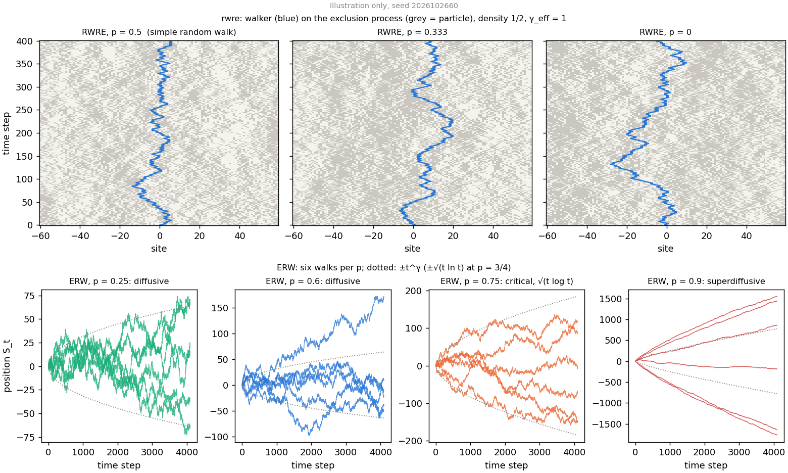
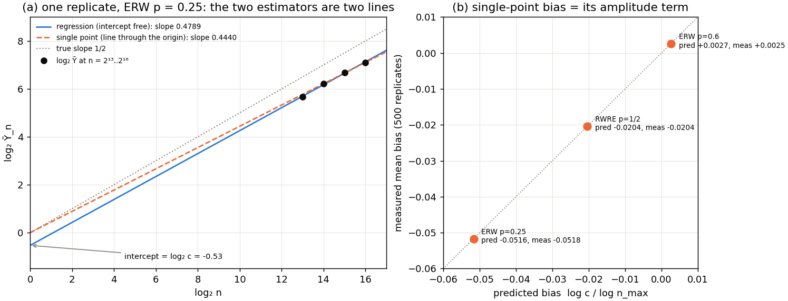
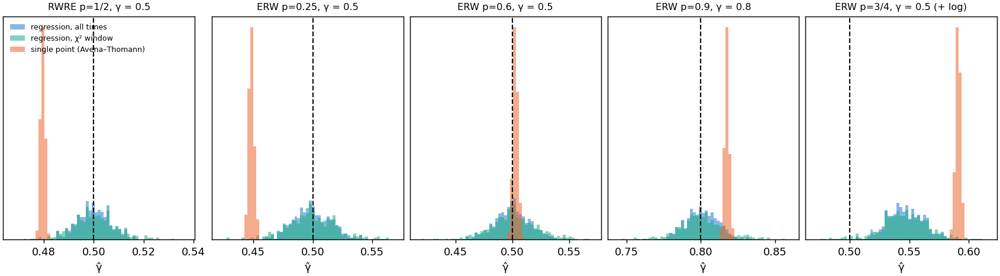
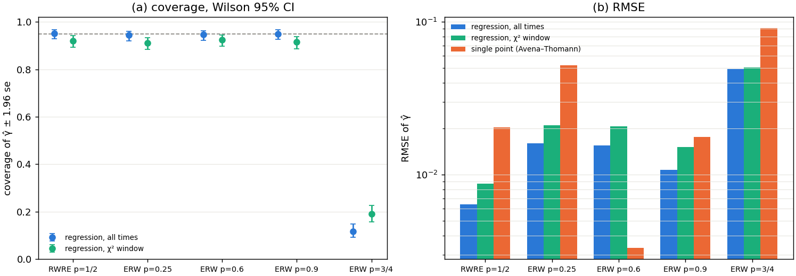
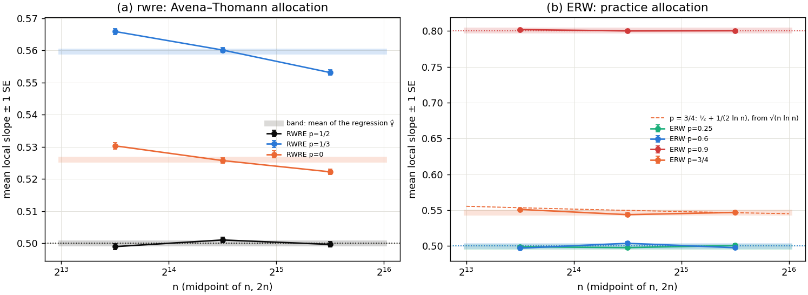

# Random walks: published allocations, the log-log estimator, and the single-point estimate

*Draft of an article section, written from experiments 44 and 45 (runs of 2026-10-26), with
context from the earlier walk experiments 02, 16, 17, 19 and 41. Commands, seeds and raw
tables are in each `experiments/NN_*/README.md`; the plan is
`plans/literature_fss_protocols.md`. Equation numbers follow `PLAN.md`'s table and were not
re-checked against `article.tex`, which is not on this host. All figures are drawn by
`experiments/plot_walk_section.py` from the stored per-replicate results.*

---

The percolation section asked whether the theorems describe $\hat\gamma$ when every constant
is measured from the simulation. This section asks a narrower question with a sharper
answer: **if one takes a published simulation protocol as it stands, with its own times
and its own number of walks, and replaces only the estimator, what changes?** Two models
make the comparison exact. For the elephant random walk the exponent is proven at every
memory parameter, so every protocol's coverage can be measured, not estimated. For the
random walk on the exclusion process there is a published numerical study whose
protocol is stated precisely enough to reproduce, and one point, $p=1/2$, where the
answer is known.

## 1. Models and observables

*Figure 1. The two models (illustration only, one seeded draw, never scored). Top: the
random walk on the simple symmetric exclusion process at three values of $p$; grey sites
hold a particle, the blue line is the walker. Bottom: six elephant random walks at each
memory parameter of experiment 45, with $\pm t^\gamma$ dotted ($\pm\sqrt{t\ln t}$ at
$p=3/4$).*

| model | walk | observable $Y_n$ | known exponent | experiment |
|---|---|---|---|---|
| `rwre_gpu_lazy` | on a 1-D exclusion process at density $1/2$: from a particle the walker steps left with probability $p$, from a hole with $1-p$; the environment is stirred at rate $\gamma_{\rm eff}=1$ relative to the walk, and simulated only where the walker has looked | $\lvert X_n\rvert$ | $\gamma=1/2$ at $p=1/2$ (a simple random walk); none proven elsewhere | 44 |
| `erw_urn_gpu` | elephant random walk: the first step is fair; step $t+1$ repeats a uniformly chosen past step with probability $p$ and reverses it otherwise | $\lvert S_n\rvert$ | $\gamma=1/2$ for $p<3/4$, $\gamma=2p-1$ for $p>3/4$; at $p=3/4$, $\mathbb E\lvert S_n\rvert\propto\sqrt{n\log n}$ | 45 |

For $p<3/4$ the ERW amplitude is also known: $\mathbb E\lvert S_n\rvert\to c\sqrt n$ with
$c=\sqrt{2/(\pi(3-4p))}$, and for the simple random walk $c=\sqrt{2/\pi}$. These
amplitudes are what make §4.2 a closed-form check rather than an observation. Our $p$ for
`rwre` is one minus the $p$ of Avena & Thomann (2012), who count right steps from a
particle. As everywhere in this repository, the known exponents are used only to score
the results; no estimator sees them (ground rule 4).

## 2. The published protocols

| | random walk on the exclusion process (44) | elephant random walk (45) |
|---|---|---|
| source | Avena & Thomann, *J. Stat. Phys.* 147, 1041 (2012), arXiv:1201.2890, Sec. 3.3 and Fig. 19 | no paper states a complete protocol; we take the practice: $M=10^3$ walks per time (Cressoni, da Silva & Viswanathan 2007) on Avena & Thomann's time grid |
| times $n$ | $2^{13},2^{14},2^{15},2^{16}$ | $2^{13},2^{14},2^{15},2^{16}$ |
| walks per time | $4712, 6120, 6120, 6120$ (Fig. 19's legend; the pairing with $n$ is assumed in increasing order) | $1000$ each |
| independence | fresh walks at every $n$ | fresh walks at every $n$ |
| published estimator | $\alpha(n)=\log\mathrm{SD}_n/\log n$, read at the largest $n$; no error bar | a log-log slope of the mean squared displacement, fit range not stated |
| per estimate | 23 072 walks, $7.4\cdot10^8$ walker steps, about 1 s on one RTX 5090 | 4 000 walks, $1.2\cdot10^8$ steps, 0.03 s |

The ERW literature is mostly analytical: Schütz & Trimper (2004) and Kumar, Harbola &
Lindenberg (2010) contain no simulations. Experiment 45 is therefore labelled as testing
the common practice, not a specific paper.

Both protocols happen to sit on the geometric grid $n=\rho^k$, $\rho=2$, that the
article's estimator is written for, with (nearly) the same number of walks at every
time. They are the closest any published protocol comes to the article's own setting.

## 3. How the estimators are used

For each published allocation we draw $R=500$ independent replicates, every one with fresh
randomness at every time (ground rule 2), and keep only each time's sample mean
$\bar Y_n$ and variance. Three estimates are formed from the same draws
(`src/budget/protocol_arm.py`).

**`full`: the article's estimator on all four times.** The least-squares slope of
$\log\bar Y_n$ on $\log n$, which on a $\rho^k$ grid is exactly the weighted sum
$\hat\gamma=\sum_k w_{k,m}\log\bar Y_{\rho^k}/\log\rho$ of eqs. (523)–(531), here with
$m=4$, $m_0=12$. Its error bar is the finite-m standard error

$$
\hat\sigma=\Bigl(\sum_k v_k^2\,\frac{\text{cv}_k^2}{n_k}\Bigr)^{1/2},\qquad
v_k=\frac{w_{k,m}}{\log\rho},
$$

with the per-time coefficient of variation $\text{cv}_k$ read off the same samples. This
is eq. (583)'s variance before the limit $m\to\infty$, and it allows the slightly unequal
$n_k$ of Avena & Thomann. The interval scored is $\hat\gamma\pm1.96\hat\sigma$. It prices
the statistical error only: no bias term is added, because no pilot is run, so no
correction is measured.

**`window`: the same regression above a data-chosen $L_{\min}$.** Finite-size-scaling
papers discard their smallest sizes until a $\chi^2$ test accepts the fit. We apply that
rule (`tools/lmin_rule.py`, thresholds fixed in advance: $\chi^2/\text{DF}\le1+2\sqrt{2/\text{DF}}$,
and no later drop of more than 2 per degree of freedom) and refit on the times it keeps.

**`single_point`: Avena & Thomann's estimator.** $\hat\alpha=\log\bar Y_{n_{\max}}/\log n_{\max}$.
They define it on $\mathrm{SD}_n$; we apply it to the same $\bar Y_n$ as the other two, so
the three differ only in how they read the same numbers.

*Figure 2. (a) One replicate of the ERW at $p=0.25$ in the log-log plane. The regression
fits a line with a free intercept, $\log c$; the single-point estimate is the slope of the
line from the origin to the last point. (b) The single-point estimator's mean bias over
500 replicates against $\log c/\log n_{\max}$, at the three points where the amplitude $c$
is known in closed form.*

Figure 2a is the whole difference between the estimators. If $\mathbb E Y_n=c\,n^\gamma$
exactly, the regression recovers $\gamma$ whatever $c$ is, because the intercept absorbs
$\log c$. The single-point estimate forces the line through the origin, so

$$
\hat\alpha=\gamma+\frac{\log c}{\log n_{\max}}+O\bigl(\text{noise}\bigr),
$$

a bias that decays only like $1/\log n$, has the sign of $\log c$, and does not shrink with
the number of walks. Avena & Thomann note this term; they do not remove it.

## 4. Results

**Wall clock.** Experiment 44: 7.4–8.4 min per point for 500 replicates; experiment 45:
14 s per point. Both on one idle RTX 5090 (xingu), seeds 202610264400–2 and
202610264500–3.

*Figure 3. $\hat\gamma$ over 500 independent replicates at every point with a known
exponent: the regression on all times (blue), the regression on the $\chi^2$ window
(green), and the single-point estimate (orange). Dashed: the true exponent.*

| point | truth | `full`: mean ± sd | `full`: bias / RMSE | `full`: coverage | `window`: coverage | `single_point`: mean ± sd | `single_point`: bias |
|---|---|---|---|---|---|---|---|
| RWRE $p=1/2$ | 1/2 | 0.5000 ± 0.0064 | −0.00002 / 0.0064 | **476/500 = 95.2%** | 453/492 = 92.1% | 0.4796 ± 0.0009 | **−0.0204** |
| ERW $p=0.25$ | 1/2 | 0.4990 ± 0.016 | −0.0010 / 0.0161 | **472/500 = 94.4%** | 445/488 = 91.2% | 0.4483 | **−0.0518** |
| ERW $p=0.6$ | 1/2 | 0.4999 ± 0.016 | −0.0001 / 0.0155 | **473/500 = 94.6%** | 457/494 = 92.5% | 0.5025 | +0.0025 |
| ERW $p=0.9$ | 0.8 | 0.8007 ± 0.011 | +0.0007 / 0.0108 | **475/500 = 95.0%** | 444/485 = 91.5% | 0.8175 | **+0.0175** |
| ERW $p=3/4$ | 1/2 (+ log) | 0.5469 ± 0.015 | **+0.0469** / 0.0493 | **58/500 = 11.6%** | 93/490 = 19.0% | 0.5910 | +0.0910 |
| RWRE $p=1/3$ | — | 0.5597 ± 0.0062 | — | — | — | 0.5347 ± 0.0008 | — |
| RWRE $p=0$ | — | 0.5260 ± 0.0066 | — | — | — | 0.5487 ± 0.0009 | — |

The `window` estimate is undefined in 6–15 replicates per point, where no $L_{\min}$
passes the rule; those replicates are left out of its coverage, not counted as hits.

*Figure 4. (a) Coverage of $\hat\gamma\pm1.96\hat\sigma$ with Wilson 95% intervals; the
single-point estimate has no interval to score. (b) RMSE of the three estimates.*

### 4.1 The regression on the published allocation is unbiased, and its error bar is right

At the four points where the exponent is a plain power law, the regression on all four
times has $|\text{bias}|\le0.001$, while its standard deviation is 0.006–0.016: the bias
is invisible at this budget. The finite-m standard error predicts that standard deviation
to within 4% (0.0066 against 0.0064 at the RWRE control), and the interval covers
94.4–95.2%, the nominal rate within its sampling error. In the article's terms, these
protocols spend everything at large $n$, where $\rho^{-\omega_1m_0}$ has already died
out, so the statistical term of eq. (720) is the whole error. This holds even at ERW
$p=0.6$, whose correction exponent is conjectured to be only $\omega=\lvert3-4p\rvert/2=0.3$
(experiment 17):
at $n\ge2^{13}$ it is below the noise.

### 4.2 The single-point estimate is biased by exactly its amplitude term

| point | $c$ | predicted $\log c/\log 2^{16}$ | measured bias | sd of the estimate |
|---|---|---|---|---|
| RWRE $p=1/2$ | $\sqrt{2/\pi}=0.798$ | $-0.0204$ | $-0.0204$ | 0.0009 |
| ERW $p=0.25$ | $\sqrt{1/\pi}=0.564$ | $-0.0516$ | $-0.0518$ | — |
| ERW $p=0.6$ | $\sqrt{2/(0.6\pi)}=1.030$ | $+0.0027$ | $+0.0025$ | — |

The prediction holds to $2\cdot10^{-4}$ at all three points (Figure 2b). Two consequences:

- **The estimate is precise and wrong.** At the RWRE control its spread is 0.0009 and its
  bias 0.0204: 23 standard deviations. Its RMSE beats the regression's only at ERW
  $p=0.6$, where $c=1.03$ happens to make $\log c\approx0$ (Figure 4b).
- **Its error changes sign with $c$, which nobody controls.** On the walk on the exclusion
  process it reads 0.025 *below* the regression at $p=1/3$ and 0.023 *above* it at $p=0$.
  Experiment 02 had found this sign change from the other side, by reading one
  long-ladder pilot at two windows; here it appears on the published allocation itself.
  A bias whose sign depends on $p$ is enough to change the shape of Avena & Thomann's
  phase diagram (their Fig. 17), whose numbers are single-point estimates.

### 4.3 Choosing the window from the data costs coverage

The $\chi^2$ rule exists to discard sizes contaminated by corrections. Here there is
nothing to discard (§4.1), so it only removes data. It drops the first time in 15–18% of
the replicates, exactly those where noise has pushed that point off the line, and refits
on three points. The RMSE rises by 31–41% and coverage falls to 91–92%, because the window
is chosen by looking at the same noise the interval is meant to describe. On a grid this
short the rule is a cost, not a safeguard.

### 4.4 Where Assumption 1 fails, every estimate is confidently wrong

At the critical $p=3/4$, $\mathbb E\lvert S_n\rvert\propto\sqrt{n\log n}$, whose local
slope on the log-log plot is $\tfrac12+1/(2\ln n)\approx0.550$ on this grid. The regression
reads $0.547$ with a standard error of 0.015 and covers 11.6% of the time; the single-point
estimate reads 0.591. The $\chi^2$ rule does not notice: a logarithm bends four points
spread over a factor of 8 in $n$ by less than their noise (Figure 5b). This is the same
lesson as percolation at the upper critical dimension: the method has no internal signal
for a logarithmic correction.

*Figure 5. Local slopes $\log(\bar Y_{2n}/\bar Y_n)/\log2$, averaged over the 500
replicates (±1 SE), on the published grid. Bands: the mean regression estimate. Dotted:
the known exponents. (a) The walk on the exclusion process. (b) The ERW, with
$\tfrac12+1/(2\ln n)$ dashed for $p=3/4$.*

### 4.5 The walk on the exclusion process away from $p=1/2$

With no truth at $p=1/3$ and $p=0$ the protocol can be judged only against longer runs.
Figure 5a shows that on $2^{13}..2^{16}$ the local slopes are still *falling*: from 0.566
to 0.553 at $p=1/3$, and from 0.530 to 0.522 at $p=0$. The regression's 0.5597 and 0.5260
are averages over a drift, and their small standard errors (0.0064) do not cover it.

- At $p=0$, experiment 19 (ladder $2^{15}..2^{20}$) gives $0.5180\pm0.0055$ and experiment 41
  ($2^{19}..2^{24}$) gives $0.5061$: the estimate keeps moving towards 1/2 as the window
  moves out, consistent with a slow correction ($\omega\approx0.15$, experiment 41).
- At $p=1/3$, experiment 02's pilot gave slopes that *rose* as the window moved up, from
  0.5631 on $4..1024$ to 0.5794 on $512..1024$. Together with the fall seen here, the
  local slope has a maximum between $10^3$ and $10^4$: the non-monotone local slope
  (the "hump") that experiment 16 studies. Whether the exponent at $p=1/3$ is above 1/2 is not
  decided by the published times, and the single-point estimate (0.5347) would place it
  0.025 lower still.

## 5. Status of the comparison with the autopilot

The plan pairs each published allocation (arm B) with `autopilot.py` at the same budget
(arm A). The published budgets turned out to be about 1 s per estimate for the walk on
the exclusion process and 0.03 s for the ERW, below what the autopilot can plan, since its
pilot and timing probes alone take tens of seconds. Two designs are open:
an amortised pilot with the tuned allocation scored at exactly arm B's budget, or both
arms scaled up to a common budget the autopilot can work with. Neither is run yet.

What can already be said: at these budgets arm B's regression is unbiased and its interval
honest wherever the exponent is a power law (§4.1). The autopilot can therefore only win
on efficiency (RMSE at equal cost), not on correctness, except where the published times
leave a drift that no statistical interval prices (§4.5).

## 6. Summary

1. **Published allocations, the article's estimator.** On the time grids of Avena &
   Thomann (2012) and the ERW literature, the log-log regression with its finite-m
   standard error is unbiased to 0.001 and covers 94.4–95.2% wherever the exponent is a
   power law, at every one of four points with a known answer.
2. **The published single-point estimator** $\log\bar Y_n/\log n$ is biased by its
   amplitude term $\log c/\log n$, which matches the closed form to $2\cdot10^{-4}$ at
   three points, reaches 0.052, is up to 23 times the estimator's own spread, and changes
   sign with $c$. The regression removes it by construction, at the price of a larger
   variance.
3. **The $\chi^2$ choice of $L_{\min}$,** standard in finite-size scaling, lowers coverage
   to 91–92% and raises RMSE by 31–41% on these short grids.
4. **Logarithmic corrections** ($p=3/4$) give a confident wrong answer (11.6% coverage)
   that no step flags, as at percolation's upper critical dimension.
5. **Away from the known points,** the published times for the walk on the exclusion
   process sit on a drifting local slope; the precision of any estimate there is real,
   its accuracy is not established by these times.
