# Critical percolation: the theorems on a model they were not built for

*Draft of an article section, written from experiments 20–40 (runs of 2026-10-08 → 2026-10-13).
Commands, seeds and raw tables are in each `experiments/NN_*/README.md`. The triage version of
this material is `experiments/percolation_summary.md`. Equation numbers follow `PLAN.md`'s
table and were not re-checked against `article.tex`, which is not on this host. Figures 1, 2
and 11 and Table 1 are drawn by `experiments/plot_percolation_results.py`, Figures 3, 7
and 8 by `experiments/plot_percolation_section.py`. The others are copies of each
experiment's own output.*

---

The random-walk testbeds of the previous sections had closed-form means and a cost
model that holds exactly. Critical percolation has neither. Its exponents are known
exactly only in $d=2$, the corrections to scaling are not known in closed form in any
dimension, and the cost of a sample depends on how the labelling algorithm meets the
memory hierarchy. It is therefore a test of whether the theorems describe the estimator
$\hat\gamma$ *as it is used*, with every constant measured from the simulation and
nothing fed in from the literature. This section reports four checks: the CLT
(eq. 583), the error-decay rate under the optimal allocation (eqs. 941, 945–946), the
coverage of the interval of Theorem eq. (720) for three different exponents, and three
end-to-end estimates of the fractal dimension $d_f$ in $d=3,4,5$. A deliberate failure
of Assumption 1 at the upper critical dimension closes the section.

## 1. Models and observables

All experiments use site percolation on $\mathbb Z^d$ at the critical point. The scale
$i$ is the side of a box (or, for $\tau$, a cluster size), and each sample $Y_i$ is
computed on a fresh, independent lattice: no lattice is reused across scales, budgets or
replicates (ground rule 2). The samplers run on one GPU (RTX 5090), one job at a time.

| exponent | observable $Y_i$ | geometry | $\gamma$ estimated | exact / literature value (acceptance only) | experiments |
|---|---|---|---|---|---|
| $d_f$, $d=2$ | open sites of an $i\times i$ box connected to the south side | cylinder (periodic in $x$) | $d_f$ | $91/48$ | 20, 22 |
| $d_f$, $d\ge3$ | open sites in the far half of an $i^d$ box connected to the face $x_0=0$ (`face_far`) | cylinder (periodic in every axis but $x_0$) | $d_f$ | 2.52293(10), 3.0446(7), 3.5260(14), 4 for $d=3,4,5,6$ | 21, 23, 27, 29–31 |
| $\tau$, $d=2$ | clusters of size $\ge s$ per site, in a torus of side $L(s)=\lceil 16\,s^{e}\rceil$ | torus | $1-\tau$ | $1-187/91$ | 25 |
| $\gamma/\nu$, $d=2$ | size of the cluster of the centre site of an $i\times i$ box (0 if closed) | box | $\gamma/\nu$ | $43/24$ | 26 |
| *pilots only:* $\tau$, $d=3$–$7$ | as for $\tau$, $d=2$, on $\mathbb Z^d$ (CPU sampler) | torus | $1-\tau$ | 2.18909(5), 2.3142(5), 2.4175(2), 5/2, 5/2 | 32–36 |
| *pilots only:* $\gamma$, $d=3$–$5$ | mean cluster size $\sum_C|C|^2/(pL^d)$ at $p=p_c-\varepsilon_0/x$, scale $x$ | torus | $\gamma$ | 1.793(3), 1.430(6), 1.1792(7) | 37–39 |
| *pilots only:* $\gamma/\nu$, $d=3$ | as for $\gamma/\nu$, $d=2$ | box | $\gamma/\nu$ | 2.0431(14) | 40 |

Figure 1 maps these experiments onto exponents and dimensions, and Figure 2 shows on a
single two-dimensional lattice what each observable counts.

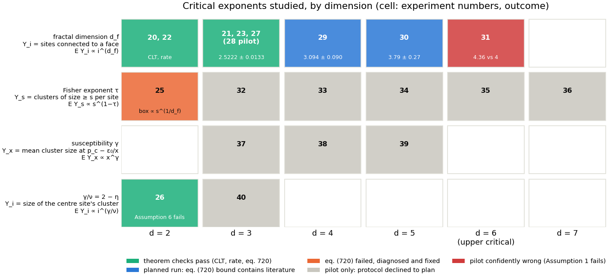

*Figure 1. The exponents studied, by dimension. Each cell names its experiments and is
coloured by outcome. Green: the theorem checks (CLT, error-decay rate, coverage of
eq. 720) pass. Blue: a planned run whose eq. (720) bound contains the literature value.
Orange: the bound failed, the cause was found and fixed. Grey: only a pilot exists,
because the protocol declined to plan a run (§7). Red: the pilot is confidently wrong
(Assumption 1 fails at the upper critical dimension).*

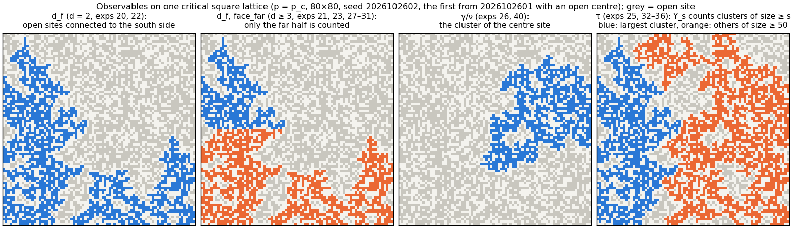

*Figure 2. The observables on one critical square lattice ($80\times80$, illustration
only). From left: sites connected to the south side ($d_f$); the same restricted to the
far half, which is the `face_far` count used for $d\ge3$, drawn here in $d=2$; the
cluster of the centre site ($\gamma/\nu$); and the cluster sizes whose tail $Y_s$
counts ($\tau$).*

$p_c$ is the literature value in every dimension ($0.59274605079210$ for $d=2$,
$0.3116077$, $0.19688561$, $0.14079633$, $0.109016661$ for $d=3$–$6$). It is a design
constant of the simulation, like the box rule, and never enters an estimator. The
`face_far` restriction is needed because the face-connected count in $d\ge5$ measures
$\max(d_f, d-1)$, the exponent of the anchoring surface. Counting only the far half of
the box recovers $d_f$ in every dimension.

The exact and literature values in the table are used only to score the results. No
estimator, pilot or allocation sees them (ground rule 4).

## 2. How the log-log estimator is used

Every number in this section comes from the same four-step protocol: *pilot → allocate →
run → bound*. Figure 3 shows it on experiment 27 ($d_f$ in $d=3$).

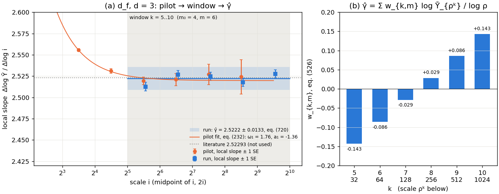

*Figure 3. The estimator on a real run (experiment 27, $d_f$, $d=3$). (a) Two-point local
slopes $\log(\bar Y_{2i}/\bar Y_i)/\log 2$ of the pilot (orange, scales 4..512) and of the
final run (blue, 32..1024), with the local slope implied by the pilot's fit of eq. (232).
The shaded window $k=5..10$ is the one the allocation chose. The band is
$\hat\gamma\pm$ the eq. (720) half-width. The literature value (dotted) is shown for
reference and was not used. (b) The weights $w_{k,6}$ of eq. (526) that combine the six
log-means of the window into $\hat\gamma$.*

**The estimator.** On the geometric ladder $i=\rho^k$ (here $\rho=2$ throughout), draw
$n$ i.i.d. samples at each of the $m$ scales $k=m_0+1,\dots,m_0+m$ and form the sample
means $\bar Y_{\rho^k}$. The article's estimator (eqs. 523–531) is

$$
\hat\beta=\sum_{k=m_0+1}^{m_0+m} w_{k,m}\,\log\bar Y_{\rho^k},\qquad
w_{k,m}=\frac{12\,\bigl(k-m_0-\tfrac{m+1}{2}\bigr)}{m(m^2-1)},\qquad
\hat\gamma=\hat\beta/\log\rho .
$$

This is the least-squares slope of the log-log plot restricted to the window (Figure 3b).
The weights are antisymmetric, so the $m/2$ lowest scales enter with negative weight.
The window has two free parameters. $m_0$ is how many scales are dropped at the bottom
of the ladder, and it controls the finite-size bias, of order $\rho^{-\omega_1 m_0}/m^2$
(Prop. 820). $n$ controls the statistical error, $\sqrt{12\sigma_\infty^2/(nm^3)}/\log\rho$
(eq. 583). We use $m=6$, except $m=5$ in experiments 23, 29 and 30. In 29 and 30 the
largest box that fits the GPU's labelling arrays caps the ladder, and $m=5$ lets the
window start one scale higher.

**Step 1: pilot.** A cheap run (about 200 s of sampling, $R=5$ independent replicates)
on a wide ladder, typically 4..512, with $n$ spread over the scales by a Neyman rule. It
measures every constant the later steps need:

- the cost exponent $\hat d$ of Assumption 7 ($\text{cost}(i)\propto i^d$), from five
  batched timing probes;
- the leading correction $(\hat\omega_1,\hat a_1)$, by fitting the one-term truncation of
  eq. (232), $\log\bar Y_i=\log a_0+\gamma\log i+a_1 i^{-\omega_1}$, with all four
  parameters free (the orange curve in Figure 3a; the fit itself is Figure 4);
- per-scale coefficients of variation $\text{cv}_k$, with $\sigma_\infty^2$ taken as
  $\text{cv}^2$ at the top scale, $\sigma_{\max}^2=\max_k\text{cv}_k^2$, and the log-moment
  $\Lambda=\max_k\mathbb E|\log\xi_k|^{3}$ of Assumption 5 (with $\delta=1$);
- the machine's throughput, to convert a wall-clock budget into a sample budget.

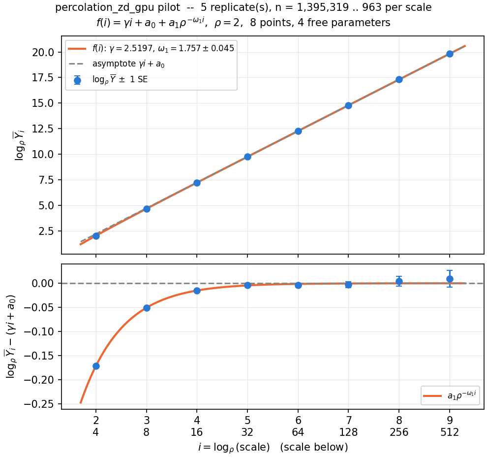

*Figure 4. Pilot fit of eq. (232) for experiment 27. Top: $\log_2\bar Y_i$ against
$k=\log_2 i$. Bottom: residual from the asymptote $\gamma k+a_0$, which is the correction
$a_1\rho^{-\omega_1 k}$. The correction is $-0.17$ (in $\log_2$ units) at $i=4$ and
about $10^{-3}$ at $i=64$. Fit: $\hat\omega_1=1.757\pm0.045$, $\hat a_1=-1.36$.*

**Step 2: allocation.** Given a budget $B$ in cost units ($B=n\sum_k\rho^{kd}$, close to
the number of lattice sites visited), Proposition (932) gives the rate-optimal allocation
$n=\kappa B^{\theta_1}$, $m_0=\theta_2\log_\rho B$, with $\theta_1=2\omega_1/(d+2\omega_1)$
and $\theta_2=1/(d+2\omega_1)$ (eqs. 945–946). The proposition is a rate statement and
drops an additive constant in $m_0$. We therefore use two versions of the rule:

- *prop:opt* is eq. (946) as stated;
- *tuned* restores the constant. Writing $|\text{bias}|=C_b\rho^{-\omega_1 m_0}$ with
  $C_b=|a_1\sum_j w_j\rho^{-j\omega_1}|/\log\rho$ and $\text{sd}=C_s n^{-1/2}$ with
  $C_s=\text{cv}\,\|w\|/\log\rho$, minimising the RMSE at fixed $B$ gives
  $m_0^{\text{tuned}}=\theta_2\bigl(\log_\rho B+\log_\rho\kappa\bigr)$ with
  $\kappa=2\omega_1C_b^2/(dC_s^2G)$ and $G=\rho^d(\rho^{dm}-1)/(\rho^d-1)$. Every input
  is a pilot measurement.

In the end-to-end runs (§6) the same computation is done by `plan.py` for a wall-clock
budget. It also reports the predicted bias and standard deviation of the run before
anything is drawn.

**Step 3: run.** $R$ independent replicates of the chosen $(n, m_0, m)$, each on fresh
lattices. $\hat\gamma$ is the closed form above. A replicate's $\hat\gamma$ is $-\infty$
when some $\bar Y_{\rho^k}=0$ (Assumption 2 fails on that draw), and it is kept as such.

**Step 4: error bar.** The interval of Theorem eq. (720) bounds $|\hat\beta-\beta|$ by
four terms:

$$
\mathcal B_{\text{fs}}+\mathcal B_{\text{good}}+\mathcal B_{\text{bad}}+\Phi^{-1}(0.975)\,\sigma_{\text{se}},
$$

the finite-size bias, the Jensen bias of $\log$ on the good event, the contribution of the
bad event where a sample mean strays far, and the statistical term. Each is evaluated
from the pilot's constants: $\mathcal B_{\text{fs}}$ from $(\hat\omega_1,\hat a_1)$,
the next two from $\sigma_{\max}^2$, $\Lambda$ and $\delta$, and $\sigma_{\text{se}}$ from
$\sigma_\infty^2$. The constants come from the pilot and not from the run, because the
run's ladder starts where the correction has died out and has nothing left to fit (Figure 3a).
The $\omega_2$ part of $\mathcal B_{\text{fs}}$ needs $\phi^+$ (Assumption 3), which we
cannot measure. It is omitted, so strictly every half-width below is a lower estimate of
the theorem's bound. For comparison we also report the Student-$t$ interval of the $R$
replicate estimates. It measures scatter only.

**Scoring.** With the true $\gamma$ known only to the scorer:

- *coverage* is the fraction of replicates with $|\hat\gamma-\gamma|$ at or below the
  half-width, with a Wilson score 95% interval on that fraction;
- the *CLT check* compares the observed $\operatorname{Var}\hat\gamma$ with eq. (583)'s
  $12\sigma_\infty^2/(nm^3\log^2\rho)$ (bootstrap CI on the ratio, 4000 resamples), and
  runs a Kolmogorov–Smirnov test of the standardised $\hat\gamma$ against
  $\mathcal N(0,1)$;
- the *rate* is the slope of $\log\text{RMSE}$ against $\log B$, with a bootstrap CI.

## 3. The central limit theorem, eq. (583)

**Setup.** One allocation per dimension, chosen by the tuned rule and repeated many times.

| | $d=2$ (exp. 20) | $d=3$ (exp. 21) |
|---|---|---|
| budget per replicate | $10^{10}$ | $2\cdot10^{11}$ |
| window | $m_0=4$, $m=6$: $i=32..1024$ | $m_0=2$, $m=6$: $i=8..256$ |
| $n$ per scale | 6 191 | 4 876 |
| replicates $R$ | 1000 | 200 |
| wall clock | 13 min | 36 min |

**Results.**

| | $d=2$ | $d=3$ |
|---|---|---|
| $\operatorname{Var}\hat\gamma$ / eq. (583) | **1.036** [0.946, 1.128] | 1.27 [1.05, 1.47] |
| $\operatorname{Var}\hat\gamma$ / exact finite-$m$ variance $\sum_j w_j^2\text{cv}_j^2/n$ | 0.971 | **1.04** |
| KS $p$-value vs $\mathcal N(0,1)$ | 0.976 | 0.14 |
| mean $\hat\gamma-\gamma$ | $+0.0017$ (1.0 sd) | $+0.0043$ (0.94 sd) |
| eq. (720) coverage | 1000/1000 | 200/200 |
| half-width / RMSE | 5.3 | 9.5 |

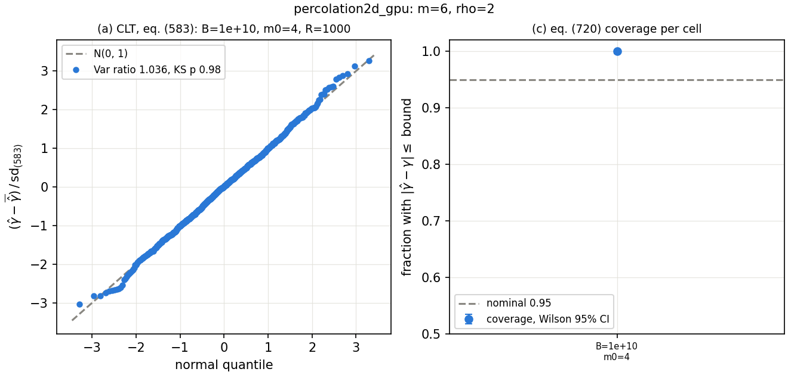
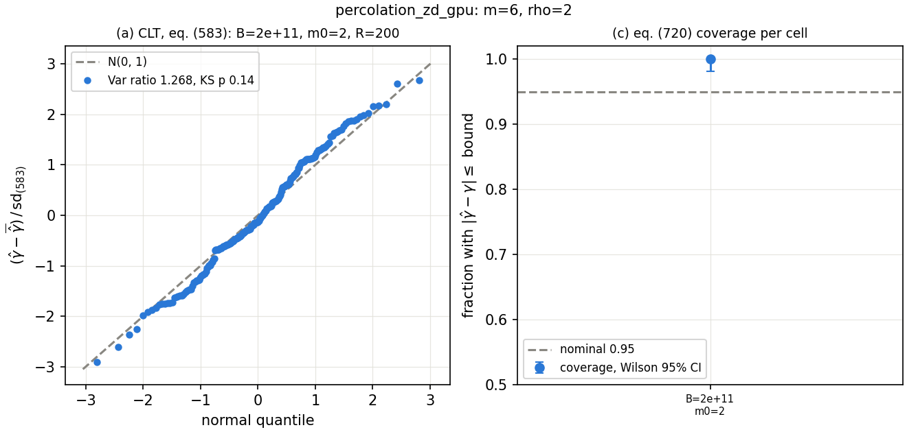

*Figure 5. CLT checks for $d=2$ (top, $R=1000$) and $d=3$ (bottom, $R=200$). Left: QQ
plot of $(\hat\gamma-\bar{\hat\gamma})/\text{sd}_{(583)}$ against $\mathcal N(0,1)$.
Right: eq. (720) coverage with its Wilson interval.*

$\hat\gamma$ is Gaussian in both dimensions. In $d=2$ its variance matches eq. (583) as
stated, with $\sigma_\infty^2$ read off the top scale. In $d=3$ the asymptotic formula
under-predicts the variance by 27%, while the exact finite-$m$ variance of the same linear
estimator matches to 4%. The cause is Assumption 6: on 8..256 the cv falls from 1.17 at
the bottom of the window to 0.83 at the top, so $\sigma_\infty^2$ taken from the top scale
is too small for the lower rungs. **For the paper:** eq. (583) holds once
$\sigma_k\to\sigma_\infty$ has converged over the window. Before that, the finite-$m$
form $\sum_k w_{k,m}^2\sigma_k^2/n$ is the right standard error. Experiments 22 and 23
(below) add 54 more CLT checks, one per cell, at $R=20$. 5 of them fail at the 5% level.
With two tests per cell, chance alone produces about
that many failures.

## 4. Error decay and the optimal allocation, eqs. (941) and (945)–(946)

**Setup.** A grid of budgets $B$ crossed with a grid of window offsets $m_0$, with $R=20$
independent replicates per cell, and $n$ set by the budget at each $(B,m_0)$. Each budget
then has an empirical best $m_0$, and the two allocation rules of §2 can be scored against
it at equal cost.

| | $d=2$ (exp. 22) | $d=3$ (exp. 23) |
|---|---|---|
| budgets | $10^9\dots10^{12}$, 6 values, ×4 apart | $10^{10}\dots10^{12}$, 6 values, ×2.5 apart |
| $m_0$ grid, $m$ | 3..7, $m=6$ | 2..5, $m=5$ |
| cells × $R$ | 30 × 20 = 600 estimates | 24 × 20 = 480 estimates |
| pilot constants | $\hat d=2.022$, $\hat\omega_1=0.629$, $\hat a_1=-0.075$, cv = 0.38 | $\hat d=3.139$, $\hat\omega_1=1.793$, $\hat a_1=-1.48$, cv = 0.91 |
| predicted rate $-\omega_1/(d+2\omega_1)$ | $-0.192$ | $-0.267$ |
| wall clock | 4 h 26 min | 2 h 40 min |

In $d=2$ the cylinder leaves only a very small correction ($a_1\approx-0.07$). The fitted
$\hat\omega_1=0.63$ is the effective exponent on this ladder, well below the leading
$\omega=3/2$. The rate check is made against the exponent the pipeline measured, since that
is what the allocation used.

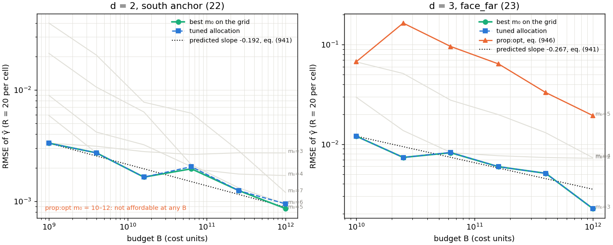

*Figure 6. RMSE of $\hat\gamma$ against budget. Thin grey: every $m_0$ on the grid. Green:
the best $m_0$ at each budget. Blue dashed: the tuned allocation. Orange: eq. (946) as
stated (in $d=2$ it is unaffordable at every budget). Dotted: the predicted slope of
eq. (941), drawn through the best arm's first point.*

**Rate.** The measured slopes contain the prediction in both dimensions.

| | predicted | best $m_0$ | tuned rule | prop:opt |
|---|---|---|---|---|
| $d=2$ | $-0.192$ | $-0.185$ [$-0.236$, $-0.149$] | $-0.174$ [$-0.228$, $-0.122$] | unaffordable |
| $d=3$ | $-0.267$ | $-0.304$ [$-0.378$, $-0.231$] | $-0.304$ [$-0.381$, $-0.232$] | $-0.354$ [$-0.440$, $-0.275$] |

The mechanism of the theorem is visible directly. In $d=2$ at fixed $m_0=3$ the bias
stays at $+0.0027$ from $B=10^9$ to $10^{12}$ while the standard deviation falls 37-fold.
The error therefore floors, and the best $m_0$ moves up the ladder as $B$ grows (from 3
to 5 in $d=2$, from 2 to 3 in $d=3$).

**The constant in $m_0$.** Eq. (946) gets the scaling of $m_0$ right but not its level:

| $d=3$, $B$ | $10^{10}$ | $2.5\cdot10^{10}$ | $6.3\cdot10^{10}$ | $1.6\cdot10^{11}$ | $4\cdot10^{11}$ | $10^{12}$ |
|---|---|---|---|---|---|---|
| best $m_0$ | 2 | 2 | 2 | 3 | 3 | 3 |
| prop:opt $m_0$ (RMSE / best) | 4 (5.6×) | 5 (22×) | 5 (12×) | 5 (11×) | 5 (6.5×) | 5 (8.6×) |
| tuned $m_0$ (RMSE / best) | 2 (1.00) | 2 (1.00) | 3 (1.01) | 3 (1.00) | 3 (1.00) | 3 (1.00) |

In $d=2$ eq. (946) asks for $m_0=10$–$12$, a ladder up to $i=2^{18}$ that leaves $n<2$
per scale below $B=1.6\cdot10^{10}$, so it cannot be run at any budget in the grid. The
tuned rule picks the best $m_0$ at 4 of 6 budgets and is never worse than 1.10× the best
RMSE. On the random walk the same omission cost a factor 2.2–2.4. On percolation it costs
up to 22× in RMSE, because the dropped constant grows with cv and with $d$. **For the
paper:** the constant $\theta_2\log_\rho\kappa$ is computable from $a_1$ and cv, and
restoring it makes the allocation rule usable as a recipe and not only as a rate.

## 5. Coverage of the interval eq. (720) for three exponents

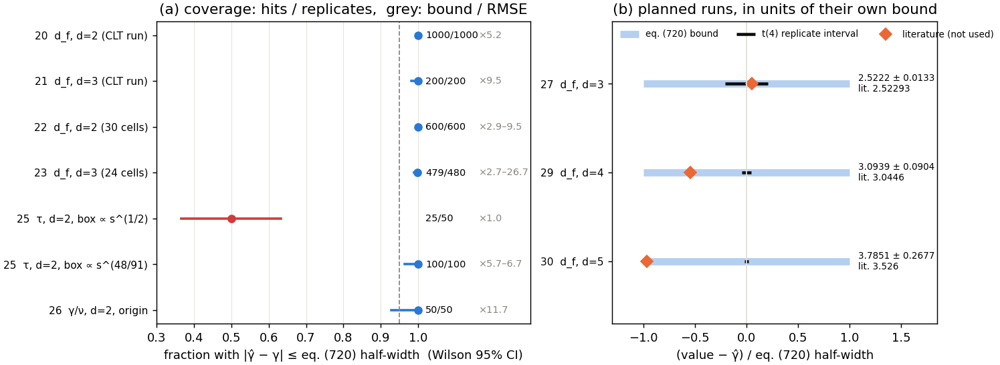

*Figure 7. (a) Coverage of eq. (720) for every scored arm, with Wilson 95% intervals. The
grey number is the half-width divided by the actual RMSE. (b) The three planned runs of
§6, each in units of its own eq. (720) half-width: the bound is the interval $[-1,1]$, the
black bar is the Student-$t$ interval of the 5 replicates, and the diamond is the
literature value.*

**$d_f$ (experiments 20–23).** 2279 of 2280 estimates are covered. The bound is
conservative by a factor of 2.7 to 27, and the factor grows with $m_0$. At low $m_0$ the
dominant term is $\mathcal B_{\text{fs}}$, at high $m_0$ (small $n$) it is
$\mathcal B_{\text{bad}}$. The one miss is the bad event itself. At $d=3$, $B=10^{10}$,
$m_0=5$, the budget leaves $n=3$ samples per scale, one replicate had a top-rung mean of
exactly 0, and so $\hat\gamma=-\infty$. Assumption 2 fails on that draw, and
$\mathcal B_{\text{bad}}$ is the term of eq. (720) that accounts for it.

**$\gamma/\nu$ (experiment 26).** The origin-cluster observable, with $B=2\cdot10^{11}$,
$m_0=6$ (window 128..4096), $n=6409$ and $R=50$. Coverage is 50/50, with mean bias
$-0.003$ and a half-width 11.7× the RMSE. Here Assumption 6 fails outright: the cv grows
from 1.27 to 1.66 across the window (the known $i^{5/48}$ drift of the origin anchor), so
$\sigma_\infty^2$ does not exist. $\hat\gamma$ is still Gaussian (KS $p=0.20$), but its
variance is 1.62 [1.10, 2.13] times eq. (583)'s. The bound still covers, because the
bias terms are large enough to absorb the shortfall in $\sigma_{\text{se}}$.

**$\tau$ (experiment 25): a failure, and its diagnosis.** Here the scale is a cluster
size $s$, $Y_s$ counts clusters of size $\ge s$ per site, and $\gamma=1-\tau$. Each scale
is drawn in a torus whose side grows with the scale, $L(s)=\lceil16\,s^{e}\rceil$, so that
the top of the ladder is not cut off by the box. With the first choice $e=1/2$ (the
budget $B=10^8$, tuned $m_0=7$, window $s=256..8192$, $n=6009$, $R=50$) the noise is as
predicted (variance ratio 1.14, KS $p=0.73$), but **coverage is 25/50**. The mean bias is
$+0.0099$, or 4.8 sd, and it sits exactly at the bound's edge (half-width / RMSE = 0.99).

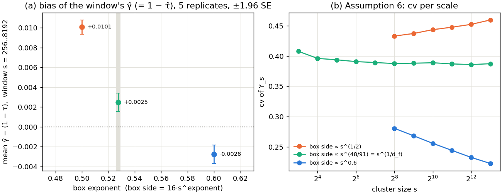

*Figure 8. Experiment 25. (a) Bias of the log-log estimator on the window $s=256..8192$
(the failing run's window), against the exponent $e$ of the box rule. Each point is 5
independent pilot replicates. (b) cv of $Y_s$ per scale: it rises for $e=1/2$, is flat
for $e=48/91=1/d_f$, and falls for $e=0.6$.*

The diagnosis came in three steps:

1. **A pilot on the run's own window** ($s=256..8192$) reproduces the bias, $+0.0101$.
   Its log-log plot is straight, so the eq. (232) fit finds no correction there
   ($\hat\omega_1\to3.8$). The bias is therefore not a correction to scaling that a longer
   ladder would outrun.
2. **The cause is the box rule.** With $e=1/2$ the ratio of the cluster-size cutoff
   $L^{d_f}$ to $s$ drifts as $s^{-5/96}$, and the cv drifts with it (Figure 8b). This
   finite-box effect bends the slope by an amount that barely decays over a decade. It
   does not look like the $i^{-\omega_1}$ corrections eq. (232) models, so the pilot
   cannot see it, $\mathcal B_{\text{fs}}$ does not price it, and the bound under-covers.
   Changing $e$ moves the bias with it (Figure 8a: $+0.0101$ at $e=1/2$, $+0.0025$ at
   $48/91$, $-0.0028$ at $0.6$).
3. **With $e=1/d_f=48/91$ the cutoff is frozen.** The cv is flat at 0.39 on every rung,
   so Assumption 6 holds. The pilot fit converges with $\hat\omega_1=0.557\pm0.024$, and
   coverage is restored: 50/50 at $m_0=7$ (bias $+0.0022$) and 50/50 at the tuned
   $m_0=8$ (bias $+0.0010$), with the half-width 5.7–6.7× the RMSE. The exponent $48/91$
   only sizes the box. It never reaches the estimator.

This is the cautionary example of the section. The interval is only as good as
Assumption 1 is for the observable. A finite-size effect that decays too slowly to fit
on the affordable ladder is invisible to the pilot, and the bound then under-covers
without any warning sign in the fitted constants.

## 6. End-to-end estimates of $d_f$ in $d=3,4,5$

Here the full protocol of §2 runs once per dimension with a wall-clock budget, as a
practitioner would use it: one pilot, one plan, $R=5$ replicates. The literature values
are used only to score the result afterwards.

| | $d=3$ (exp. 27) | $d=4$ (exp. 29) | $d=5$ (exp. 30) |
|---|---|---|---|
| window, $n$ per scale | 32..1024 ($m_0=4$, $m=6$), 24 399 | 8..128 ($m_0=2$, $m=5$), 10 260 | 4..64 ($m_0=1$, $m=5$), 2 181 |
| wall clock, planned → actual | 360 → 589 min | 45 → 58.5 min | 45 → 51.9 min |
| $\hat d_f\pm$ eq. (720) | **2.5222 ± 0.0133** | **3.0939 ± 0.0904** | **3.7851 ± 0.2677** |
| largest term | $\mathcal B_{\text{bad}}$ 0.0088 | $\mathcal B_{\text{fs}}$ 0.072 | $\mathcal B_{\text{fs}}$ 0.226 |
| $t(4)$ replicate interval | [2.5194, 2.5250] | [3.0898, 3.0980] | [3.7802, 3.7900] |
| literature | 2.52293(10) | 3.0446(7) | 3.5260(14) |
| actual error | $-0.0007$ | $+0.049$ | $+0.259$ |
| plan's predicted error | 0.0012 | bias 0.048 | bias 0.157 |
| literature inside the bound? | yes | yes | yes, by 0.009 |
| literature inside the $t$ interval? | yes | **no** | **no** |

In $d=4$ and $5$ the ladder is capped by the largest box whose cluster labels fit in
32-bit integers ($128^4$ and $64^5$ sites), so a larger budget buys more samples but no
more depth. The plans were cut to 45 minutes for that reason.

- **$d=3$** is 3× tighter than the earlier best bound from this repository (±0.040), and
  the actual error (0.0007) is what the plan predicted (0.0012). The bound is 11× the
  predicted RMSE, almost all of it $\mathcal B_{\text{bad}}$, which the plan does not
  model.
- **$d=4$** is the clearest case for eq. (720). The replicate interval is confidently
  wrong: it is 0.008 wide and misses the literature value by 0.045. The bound contains it,
  and its bias term was predicted from the pilot to within 2% (0.048 against 0.049).
- **$d=5$** shows the limit of a one-correction fit on a short ladder. The pilot
  (4..64) sees fast curvature and under-predicts the bias by 1.65×. The bound still covers,
  by 0.009.

The planned wall clock was exceeded by 1.15–1.64×. Experiment 24 locates the cause
(Figure 10 below): the cost per site is flat on the middle of every ladder, as Assumption 7
says, but roughly doubles once one sample exceeds about $10^8$ sites. A plan whose ladder
ends above the pilot's timing probes therefore extrapolates the wrong throughput.

## 7. Where the method fails

**At the upper critical dimension (experiment 31).** In $d=6$, $d_f=4$ with
multiplicative logarithmic corrections, which eq. (232) cannot represent. We ran the
pilot to see whether the method notices.

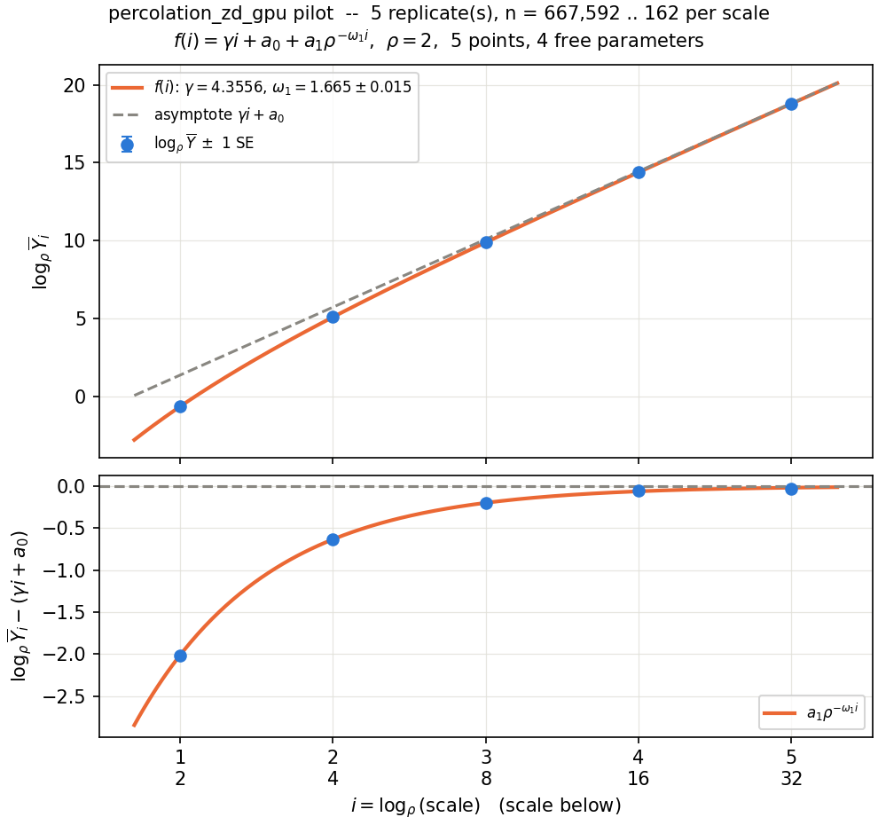

*Figure 9. Pilot fit of eq. (232) at $d=6$ (scales 2..32). The fit converges with a
tight $\hat\omega_1=1.665\pm0.015$ and gives $\hat\gamma=4.356$ against the mean-field
value 4.*

It does not notice. The fit converges, $\hat\omega_1$ is determined to 1%, every
triage gate passes, and the pilot reports $\hat d_f=4.36$. A planned run would only make
this wrong answer more precise. No internal diagnostic in the protocol detects
logarithmic corrections. This is a genuine limitation, and the paper should state it
next to Assumption 1.

**When $\omega_1$ cannot be identified (experiments 32–40).** For $\tau$ in $d=3$–$7$,
$\gamma$ in $d=3$–$5$ and $\gamma/\nu$ in $d=3$, the pilot either left $\omega_1$ or $a_1$
unidentified (standard error comparable to the value), failed to converge, or measured a
cost exponent more than 5% off the declared one. In each of these cases the protocol
declined to plan a run, so no bound was produced. This is the intended behaviour. The
$d=6$ case above is the one counterexample: an identifiable but wrong correction.

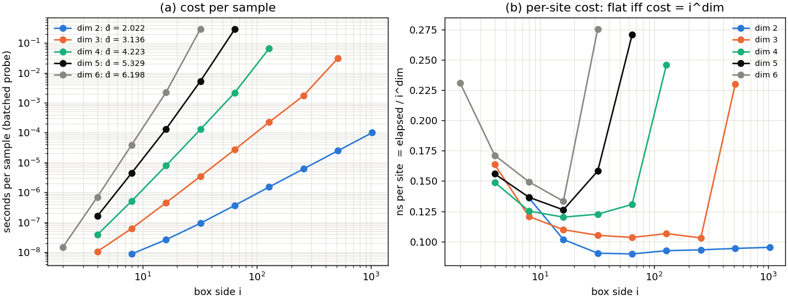

*Figure 10. Assumption 7 across dimensions (experiment 24, from the pilots' timing
probes). (a) Seconds per sample against box side. (b) Nanoseconds per site: flat
mid-ladder in every dimension, jumping at the top rung once a sample exceeds about
$10^8$ sites. The fitted $\hat d$ exceeds the dimension by 1–7% only because of that
last rung.*

## 8. All results at a glance

Table 1 lists every experiment that produced an estimate. Figure 11 shows the same rows
on one axis: the actual error against the literature value next to the half-width of
the eq. (720) bound.

*Table 1. All estimates. **Bold**: planned end-to-end runs (§6). *(pilot)*: the pilot's
eq. (232) fit only, with no bound. Other rows are theorem-check cells. For those, the
estimate is the mean $\hat\gamma$ over the cell's $R$ replicates, "covered" counts
replicates inside the bound, and for 22, 23 and 25b the cell is the tuned allocation at
the largest budget. "samples" counts every draw of the experiment's run (every cell for
the sweeps, all replicates). "pilot" is the pilot's sampling time and "run" the run's
wall clock, both on one RTX 5090 (the $\tau$ pilots 32–36 ran on CPU). For $\tau$ rows
the estimate is $1-\hat\gamma$.*

| exp | exponent | d | estimate | ± eq. (720) | literature | error | covered | window (scales), m₀ | n per scale × R | samples | pilot | run |
|---|---|---|---|---|---|---|---|---|---|---|---|---|
| 20 | d_f | 2 | 1.8975 | 0.0122 | 91/48 | +0.0017 | 1000/1000 | 32..1024 (6), m₀=4 | 6,191 × R=1000 | 3.71e+07 | 3 min | 13 min |
| 22 | d_f | 2 | 1.8964 | 0.0042 | 91/48 | +0.0006 | 20/20 | 128..4096 (6), m₀=6 | 37,361 × R=20, 30 cells | 5.34e+08 | 3 min | 4.4 h |
| 21 | d_f | 3 | 2.5272 | 0.0593 | 2.52293(10) | +0.0043 | 200/200 | 8..256 (6), m₀=2 | 4,876 × R=200 | 5.85e+06 | 3 min | 36 min |
| 23 | d_f | 3 | 2.5214 | 0.0235 | 2.52293(10) | -0.0015 | 20/20 | 16..256 (5), m₀=3 | 24,448 × R=20, 24 cells | 4.03e+07 | 3 min | 2.7 h |
| 27 | d_f | 3 | **2.5222** | 0.0133 | 2.52293(10) | -0.0007 | yes | 32..1024 (6), m₀=4 | 24,399 × R=5 | 7.32e+05 | 3 min | 9.8 h |
| 28 | d_f | 3 | 2.5585 *(pilot)* | — | 2.52293(10) | +0.0356 | — | 4..512 (8) | 1,395,319..963 × R=5 | 1.08e+07 | 5 min | — |
| 29 | d_f | 4 | **3.0939** | 0.0904 | 3.0446(7) | +0.0493 | yes | 8..128 (5), m₀=2 | 10,260 × R=5 | 2.56e+05 | 4 min | 58 min |
| 30 | d_f | 5 | **3.7851** | 0.2677 | 3.5260(14) | +0.2591 | yes | 4..64 (5), m₀=1 | 2,181 × R=5 | 5.45e+04 | 4 min | 52 min |
| 31 | d_f | 6 | 4.3556 *(pilot)* | — | 4 (+ logs) | +0.3556 | — | 2..32 (5) | 667,592..162 × R=5 | 3.81e+06 | 4 min | — |
| 25a | τ | 2 | 2.0450 | 0.0100 | 187/91 | -0.0099 | 25/50 | 256..8192 (6), m₀=7 | 6,009 × R=50 | 1.80e+06 | 13 s | 13 min |
| 25b | τ | 2 | 2.0539 | 0.0186 | 187/91 | -0.0010 | 50/50 | 512..16384 (6), m₀=8 | 1,756 × R=50, 2 cells | 1.63e+06 | 5 min | 25 min |
| 32 | τ | 3 | 2.1957 *(pilot)* | — | 2.18909(5) | +0.0066 | — | 8..4096 (10) | 18,851..437 × R=5 | 2.72e+05 | 11 min | — |
| 33 | τ | 4 | 2.3519 *(pilot)* | — | 2.3142(5) | +0.0377 | — | 8..4096 (10) | 8,385..152 × R=5 | 1.15e+05 | 12 min | — |
| 34 | τ | 5 | 2.5948 *(pilot)* | — | 2.4175(2) | +0.1773 | — | 8..4096 (10) | 5,317..69 × R=5 | 6.89e+04 | 16 min | — |
| 35 | τ | 6 | 2.7827 *(pilot)* | — | 5/2 (+ logs) | +0.2827 | — | 8..1024 (8) | 2,967..114 × R=5 | 3.89e+04 | 14 min | — |
| 36 | τ | 7 | 2.4451 *(pilot)* | — | 5/2 | -0.0549 | — | 8..1024 (8) | 584..10 × R=5 | 6.58e+03 | 14 min | — |
| 37 | γ | 3 | 1.7986 *(pilot)* | — | 1.793(3) | +0.0056 | — | 4..256 (7) | 66,825..284 × R=5 | 5.58e+05 | 7 min | — |
| 38 | γ | 4 | 1.4278 *(pilot)* | — | 1.430(6) | -0.0022 | — | 2..128 (7) | 525,401..1,955 × R=5 | 4.33e+06 | 60 min | — |
| 39 | γ | 5 | 1.2050 *(pilot)* | — | 1.1792(7) | +0.0258 | — | 4..64 (5) | 24,047..469 × R=5 | 1.91e+05 | 15 min | — |
| 26 | γ/ν | 2 | 1.7885 | 0.0959 | 43/24 | -0.0031 | 50/50 | 128..4096 (6), m₀=6 | 6,409 × R=50 | 1.92e+06 | 4 s | 14 min |
| 40 | γ/ν | 3 | 2.0097 *(pilot)* | — | 2.0431(14) | -0.0334 | — | 4..256 (7) | 1,974,161..3,855 × R=5 | 1.53e+07 | 65 s | — |

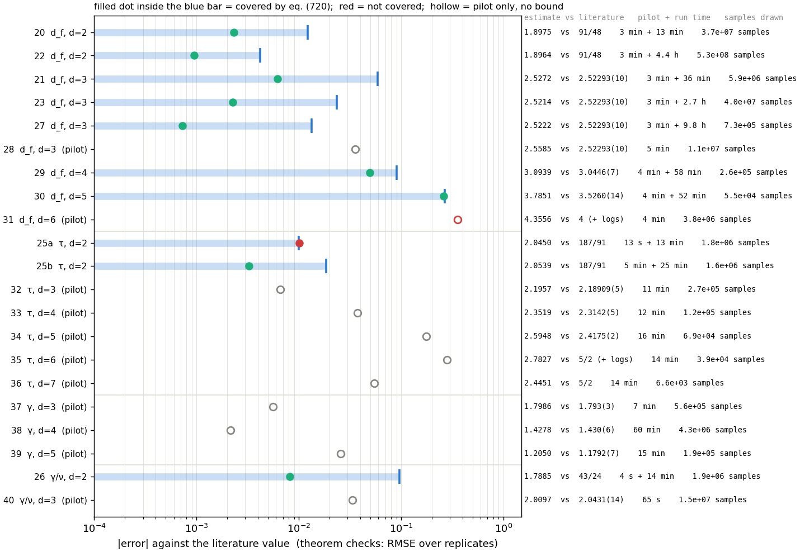

*Figure 11. Every estimate against the literature, on a log scale. For a bounded row,
the blue bar runs up to the eq. (720) half-width, and the dot is the actual error (the
RMSE over replicates for theorem-check cells). A dot inside its bar is covered. Hollow
dots are pilots, which have no bound. The right column gives the estimate, the literature
value, the pilot and run times and the number of samples drawn.*

Three observations:

- **Sample counts do not measure cost.** The run of experiment 27 draws only
  $7.3\cdot10^5$ samples but takes 9.8 h, because each sample at $i=1024$ is a
  $10^9$-site lattice. Experiment 22 draws 700 times more samples in 4.4 h. The budget
  that enters the theorems is $\sum_k n\,\rho^{kd}$, not $nm$.
- **Accuracy grows with the depth of the ladder, not with the budget.** In $d=4$ and
  $5$ the box cap leaves 4..128 and 4..64. The error is then bias (+0.049, +0.259), the
  bound is dominated by $\mathcal B_{\text{fs}}$, and the replicate scatter is
  negligible.
- **Declining to plan is a statement about $\omega_1$, not about the point estimate.**
  Pilots 37 and 38 sit within 0.006 and 0.002 of the literature $\gamma$, yet the
  protocol declined to plan them, because without an identified $\omega_1$ it cannot size
  $m_0$ or $\mathcal B_{\text{fs}}$. Pilot 34 ($\tau$, $d=5$) is off by 0.18 for the
  same reason. Without the bound, the two cases cannot be told apart.

## 9. Summary

1. **Rate (eq. 941).** It holds on percolation in $d=2$ and $d=3$, with every constant
   measured from the simulation.
2. **Allocation (eq. 946).** It has the right scaling but drops a constant that costs up
   to 22× in RMSE (or makes the allocation unaffordable). Restoring the constant from
   $a_1$ and cv recovers the empirical optimum at every budget, to within 1.10×.
3. **CLT (eq. 583).** $\hat\gamma$ is Gaussian in every case tested. The asymptotic
   variance is accurate when Assumption 6 has converged on the window. Otherwise it
   under-predicts the variance (by 27% in experiment 21 and 62% in experiment 26). In
   experiment 21 the finite-$m$ variance $\sum w_{k,m}^2\sigma_k^2/n$ closes the gap.
4. **Interval (eq. 720).** It covered 2279/2280 estimates for $d_f$, 50/50 for
   $\gamma/\nu$, 100/100 for $\tau$ with a well-posed box rule, and every planned run. It
   is conservative by 3–27×. It failed only when the observable's finite-size effect was
   not of the form eq. (232) assumes ($\tau$ with $e=1/2$), and in that case it failed
   silently.
5. **Limits.** Logarithmic corrections ($d=6$) produce a confident wrong answer that no
   step of the protocol flags. An unidentifiable $\omega_1$ makes the protocol decline
   to plan, which is the safe outcome.
